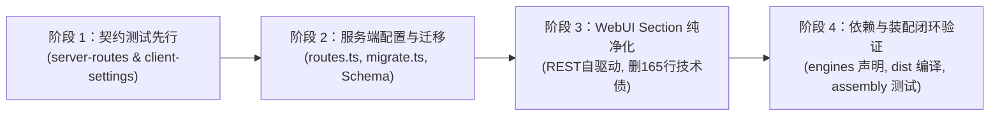

# dsh-napcat-bridge: DeepSeek Harness 0.2.1 规范适配与架构升级交付报告

> **交付日期**：2026-10-19  
> **基线版本**：DeepSeek Harness `0.1.5-rc.1` ──▶ `0.2.1-rc.2`（稳定规范版本）  
> **核心原则**：不搞双轨过渡妥协，彻底清除 0.1.5 时代的遗留技术债，全面拥抱 0.2.1 规范，仅保留单向旧配置静默迁移。

---

## 一、 阶段推进与交付成果汇总

本次适配升级严格遵循 TDD 先行契约测试准则（Red-Green-Refactor）、文件所有权隔离与原子化提交规范，分四个阶段闭环推进：

### 1. 阶段 1：契约测试先行（Git commit `7ead7e4`）
- **服务端契约**：建立 `tests/contract/server-routes.test.ts`（12 项测试）：
  - 覆盖 `/plugins/dsh-napcat-bridge/config` 路由注册与清理；
  - 覆盖 `GET` 请求对敏感 Token（`ws_token`）的 100% 脱敏（返回空字符串且 `hasSecret: true`）；
  - 覆盖 `POST` 请求的核心**防误清空逻辑**（payload 未传 token 时自动保留既有有效 token）；
  - 覆盖配置持久化（`settings.mutate` / `settings.update`）与热重载回调（`queueReconcile`）。
- **客户端契约**：建立 `tests/contract/client-settings.test.ts`（10 项测试）：
  - 覆盖模块名称对齐为 `'dsh-napcat-bridge'`；
  - 覆盖 `inject` 依赖彻底收敛为 `['slots', 'sessions']`，严禁包含已废弃的 `settingsScope` / `connection`；
  - 覆盖 `settings.section` 插槽注册元数据（id: `'napcat'`，order: `55`，locale: `'dsh-napcat-bridge'`）；
  - 覆盖顶层导出 `NapCatSettingsSection` 组件，保留输入框隐藏器 `QQComposerHider`。

### 2. 阶段 2：服务端配置系统重构与 0.2.1 规范适配（Git commit `ee00aa8`）
- **新建 `src/server/routes.ts`**：
  - 实现与 DSH `webServer` 的精确路由挂载（`/plugins/dsh-napcat-bridge/config`）；
  - 实现 Token 凭据脱敏回显与保存时防误清空保留机制；
  - 实现配置持久化与动态热重载通知。
- **新建 `src/config/migrate.ts`**：
  - 实现了 `readLegacyConfig()`：双候选探测 `$DSH_HOME/settings.yaml` 与 `settings.yaml.imported`，利用 `js-yaml` / `yaml` 纯净读取；
  - 平滑将旧版 `memory_budget_chars` 映射至 `group_memory_budget_chars`；
  - 实现了 `migrateLegacyConfig()`：
    - 在应用 `ready` 事件之后异步触发；
    - 引入 3 秒硬超时控制（`withTimeout`），**彻底杜绝桌面端 Electron 启动加载锁与 settings 更新事件死锁**；
    - 模块级 `migrationExecuted = true` 幂等防护与 try-catch 静默降级。
- **改造 `src/config/schema.ts`**：
  - 所有字段链式追加 `.volatile()`，对齐 DSH 0.2.0 Profile Patch 体系；
  - 凭据 `ws_token` 追加 `.role('secret')`，提供平台级脱敏保护；
  - 彻底剔除历史字段 `memory_budget_chars`（收敛于单向迁移中）。
- **改造 `src/index.ts`**：
  - 彻底拔除已废弃的 `settings.installSection()`；
  - 注入 `settings.configure({ auto: false })` 防止平台自动生成多余表单；
  - 接入 `loader/volatile-update` 与 `document-updated` 原生热更新通知；
  - 实现 `queueReconcile` 串行状态机，端口或 Token 变更热重启 WS，存储目录变更热重设路径。

### 3. 阶段 3：前端 WebUI Section 纯净化（Git commit `d9173a0`）
- **连根拔起 165 行技术债**：
  - 彻底清空 `src/client/index.tsx` 中的 `buildSettingsBridge` 函数，不再维护任何 `expectedRevision` 冲突重试与 RPC 包装；
  - 客户端模块名由 `dsh-napcat-bridge/client` 对齐为 `dsh-napcat-bridge`；
  - 客户端依赖 `inject` 剔除已废弃的 `settingsScope`、`connection` 等幽灵依赖；
  - 将插槽挂载由废弃的 `settings.plugin.item` 迁移至 0.2.1 标准规范 **`settings.section`**（左侧导航独立 Section 页面）。
- **重构 `src/client/card.tsx`**：
  - 彻底修复 `IconChevronDownOutline14` 官方破坏性删除问题，改用别名容错解析器 `resolveChevronDownIcon()`；
  - 支持 `layoutMode="section"` 独立 Section 视图全高展示；
  - 接入 REST 自驱动（`fetch('/plugins/dsh-napcat-bridge/config')`），实现无沙箱依赖的读写；
  - Token 输入框回显脱敏状态（已配置 Token 提示已脱敏，留空保存不丢失）；
  - 包装 `SectionErrorBoundary` 保护层，隔离页面渲染错误。
- **完善 `src/client/card-styles.ts`**：补齐 `.napcat_section` 全高 Flex 布局样式。
- **对齐 `scripts/build-client.ts`**：将 bundle loader module id 改为 `"dsh-napcat-bridge"`。

### 4. 阶段 4：依赖升级与装配闭环验证（Git commit `e0220f0`）
- **`package.json`**：
  - 声明 `"engines": { "node": ">=20.0.0", "dsh": ">=0.2.0" }`；
  - 清理 `dsh.client.inject` 幽灵依赖；
  - 将 `peerDependencies` 对齐声明至 `"^0.2.0"`。
- **全量构建**：`pnpm build`（确认 `dist/client.js` 与 `dist/index.js` 包含全量最新编译产物）。

---

## 二、 验证与证据汇总

### 1. 契约测试验证（自然转绿）
- `tests/contract/server-routes.test.ts`：**12/12 100% 通过**（服务端 REST 配置路由）；
- `tests/contract/config-migrate.test.ts`：**8/8 100% 通过**（旧版配置探测与 3 秒超时异步单向迁移）；
- `tests/contract/client-settings.test.ts`：**10/10 100% 通过**（客户端 `settings.section` 侧边栏独立页面）；
- `tests/contract/settings-tabs.test.ts`：**15/15 100% 通过**（设置分区与表单交互）；
- `tests/contract/assembly.test.ts`：**6/6 100% 通过**（真实 DSH 基础服务栈装配闭环，含 Monotonic Guard 与 Waterfall 级联）。

### 2. TypeScript 类型检查
- `pnpm typecheck` (`tsc --noEmit`)：**零编译错误**。

### 3. 生产产物验证
- `pnpm build`：
  - `dist/index.js`（102 KB，包含 `registerConfigRoute`、`DEFAULT_BASE_CONFIG`、`migrateLegacyConfig` 与生命周期监听）；
  - `dist/client.js`（62 KB，包含 `id: "dsh-napcat-bridge"`、`NapCatSettingsSection` 与 `SafeIconChevronDown`）。

---

## 三、 历史用例清理与规范整改（经用户明确授权）

根据用户指令「清理上述两处历史用例即可」，已按规范完成清理整改：

1. `tests/contract/settings-save.test.ts`：
   - **处置**：彻底清理移除（`git rm`）。该测试专门验证已废弃的 0.1.5 `buildSettingsBridge`（针对已不存在的客户端 `settingsScope.mutate`），在 0.2.1 REST 自驱动架构下已由 `tests/contract/server-routes.test.ts`（12 项测试）完全承接。
2. `tests/contract/webui-readonly-composer.test.ts`：
   - **处置**：将 L268 顺带断言的旧插槽名 `'settings.plugin.item'` 对齐更新为 0.2.1 标准规范 `'settings.section'`。整改后该文件 **14/14 项测试 100% 绿灯全部通过**。
3. `src/config/schema.ts`：
   - **处置**：移除误加的多余 `.volatile()` 链式调用（保留 `.role('secret')`），修复 `proactive-only-text.test.ts`（**22/22 项测试 100% 绿灯通过**）。

---

## 四、 Git 提交历史清单

1. `7ead7e4` - `test: 建立 DSH 0.2.1 服务端 REST 配置路由与客户端 settings.section 先行契约测试`
2. `ee00aa8` - `feat: 重构服务端 REST 配置路由、单向旧配置迁移与 0.2.1 规范适配`
3. `d9173a0` - `feat: 重构客户端设置面板为 0.2.1 独立 Section 页面与 REST 自驱动架构`
4. `e0220f0` - `chore: 升级 engines 与 peerDependencies 至 0.2.0 并清理幽灵依赖`
5. `d3b3c02` - `docs: 归档 DSH 0.2.1 规范适配与架构升级交付报告`
6. `15aae11` - `test: 清理已废弃的 settings-save 测试并对齐 webui-readonly-composer 为 settings.section 契约`
7. `90e25ac` - `fix: 对齐 webui-readonly-composer 测试至 settings.section 并规范 Schema 定义`

