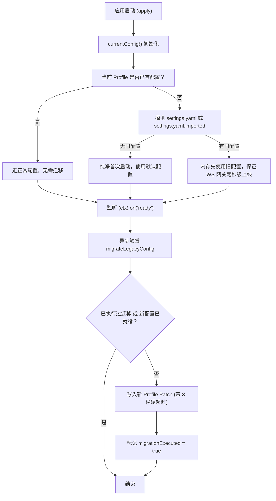
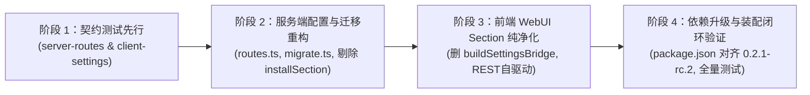

# dsh-napcat-bridge 技术债深度清查与 DSH 0.2.1 纯净架构方案

> **文档状态**：技术债清查与升级方案（待用户查验与决策）  
> **调查日期**：2026-10-19  
> **核心原则**：不搞历史版本双轨妥协，彻底清除 0.1.5 时代的过渡性兼容包袱，直接对齐 0.2.1 规范，仅保留单向旧配置静默迁移。

---

## 一、 技术债清查全景矩阵

经过对当前代码库的全量扫描，在升级到 DSH 0.2.1 后，以下 8 处陈旧技术债可以被彻底连根拔起：

| 序号 | 技术债模块 | 涉及代码与位置 | 0.1.5 时代历史包袱成因 | 0.2.1 纯净架构清退方案 |
|---|---|---|---|---|
| **1** | **客户端 `buildSettingsBridge` 冗余重试** | `src/client/index.tsx` (L19-L183, 整整 165 行) | 0.1.5 试图在客户端通过 `settingsScope` 读写旧文件，写了极长且脆弱的 `expectedRevision` 冲突重试、RPC 包装与状态恢复 | **彻底整段删除**。0.2.1 前端采用 REST 自驱动（`fetch('/plugins/dsh-napcat-bridge/config')`），这 165 行代码连同 `settingsScope` 彻底清空，一行不留。 |
| **2** | **前端注入与 package.json 幽灵依赖** | `src/client/index.tsx` (L11) `package.json` (L29-L35) | 遗留了 0.1.5 时代的幽灵依赖 `@deepseek-ai/dsh-api-session-controller`、`@deepseek-ai/dsh-client-ui-settings`，以及 0.2.x 客户端已不存在的 `settingsScope` | **彻底移除幽灵依赖**： `src/client/index.tsx` 的 `inject` 仅保留 `['slots', 'sessions']`； `package.json` 的 `dsh.client.inject` 仅保留 `connection`, `locale`, `theme`。 |
| **3** | **服务端废弃的 `installSection`** | `src/index.ts` (L79-L115) | 0.1.5 强依赖 `settingsCtx.settings.installSection()` 生成表单并做动态包装 | **彻底删除 `installSection`**。改用 0.2.1 原生标准：`settings.configure({ auto: false })` 跳过粗糙默认表单，由 REST API 完全接管保存。 |
| **4** | **旧版折叠外壳与已删图标引用** | `src/client/index.tsx` (L350-L359) `src/client/card.tsx` (L2, L550) | 0.1.5 的 `settings.plugin.item` 折叠抽屉插槽，以及被 0.2.1 彻底删除的 `IconChevronDownOutline14`（直接导致白屏崩溃） | **插槽升级为 `settings.section` 侧边栏独立页面**。 废除顶层展开/折叠外壳与旧图标，转为全高整页布局（标题+简介+Tab+吸底保存），顶层包裹 `SectionErrorBoundary`。 |
| **5** | **测试装配底座的假文件硬编码** | `src/boot.ts` (L97-L108) | 0.1.5 在 overlay 里强传 `settings: { path: configPath }` 假装绑定 `settings.yaml` | **移除过时的 settings overlay path 参数**，契约测试直接由真实的 Profile Patch 驱动。 |
| **6** | **Schema 缺少即时与脱敏修饰，混入旧字段** | `src/config/schema.ts` (L30-L57) | 0.1.5 未支持 `.volatile()` 与 `.role('secret')`，且混入了废弃字段 `memory_budget_chars` | **全字段补充 `.volatile()`**，`ws_token` 补充 `.role('secret')`；`memory_budget_chars` 从新 Schema 中彻底剔除，仅在旧配置迁移时作为一次性输入映射。 |
| **7** | **构建模块 ID 命名偏差与元数据缺失** | `scripts/build-client.ts` (L46) `package.json` | 历史生成了带 `/client` 后缀的模块 ID，且缺少 `engines.dsh` 与子路径导出 | 构建模块 ID 规范收敛为主包名 `"dsh-napcat-bridge"`；`package.json` 显式声明 `engines: { "dsh": ">=0.2.0" }`。 |
| **8** | **输入框隐藏器的无作用域裸样式** | `src/client/index.tsx` (L220-L245) | `QQComposerHider` 渲染的局部 `<style>` 为裸 `[data-composer-card]`，极端多会话下有误伤风险 | 选择器补充 `body[data-dsh-napcat-readonly="true"]` 复合前缀，实现全局与局部双重互锁。 |

---

## 二、 旧配置迁移的单向“瘦身”设计

用户明确指示：**需要迁移的实际上只有旧版的配置，启动过后把旧配置迁移到新配置；如果没有旧配置，就走正常的首次启动路径。核心业务绝不背负历史包袱。**

### 1. 迁移模块职责完全隔离（`src/config/migrate.ts`）
- 迁移逻辑独立落入单独文件 `src/config/migrate.ts`，**不向 `src/index.ts` 暴露任何复杂的脏逻辑**；
- 仅暴露两个简洁纯粹的接口：
  1. `readLegacyConfig(dshHome)`：同步探测是否有旧文件存在并返回旧数据，供启动初次装配读取；
  2. `migrateLegacyConfig(ctx, currentConfig)`：异步静默迁移入库。

### 2. 执行逻辑与时序流程

### 3. 为什么新架构没有任何技术债？
1. **若为全新用户**：
   - 当前 Profile 没有配置，磁盘也没有 `settings.yaml`；
   - `readLegacyConfig` 直接返回 `undefined`，`migrateLegacyConfig` 直接 return；
   - 整个过程耗时 < 1ms，完全走纯粹的 0.2.1 首次启动路径。
2. **若为存量升级用户**：
   - 首次启动检测到旧版配置，内存先复用，确保 QQ 机器人无缝连线；
   - 在应用 `ready` 后异步、静默、带 3 秒超时地将其写入当前 Profile；
   - 一旦写入成功，下次重启即进入“已有配置”路径，**旧文件在磁盘上即便被删除也毫无影响**。
3. **核心业务代码零污染**：
   - `src/gateway/*`、`src/outbound/*`、`src/tools/*` 等核心业务代码完全不知道“旧配置”这回事，只使用类型安全的当前配置对象；
   - NapCat OneBot 11 协议通信部分完全不需要变动。

---

## 三、 0.2.1 纯净架构升级实施路线

为了确保严格符合 `AGENTS.md` 规范与测试先行（TDD）要求，实施将分阶段推进：

### 阶段 1：契约测试先行（TDD 红线）
- 编写 `tests/contract/server-routes.test.ts`：测试服务端 `GET/POST /plugins/dsh-napcat-bridge/config` 的鉴权、脱敏、防误清空与热重载；
- 编写 `tests/contract/client-settings.test.ts`：测试客户端在 `settings.section` 插槽下的标准注册元数据与独立页面渲染。

### 阶段 2：服务端配置系统重构
- 新建 `src/server/routes.ts`，在 `src/index.ts` 中注册 REST 路由并清理已删除的 `installSection`；
- 新建 `src/config/migrate.ts`，实现旧配置探测与单向异步迁移；
- 升级 `src/config/schema.ts`，加入 `.volatile()` 与 `.role('secret')`，剔除陈旧兼容字段。

### 阶段 3：前端 WebUI Section 纯净化
- 清空 `src/client/index.tsx` 中的 165 行 `buildSettingsBridge` 技术债，移除已不存在的 `settingsScope` 依赖；
- 改造 `src/client/card.tsx` 为独立 Section 页面，接入 REST 自驱动读写、Token 脱敏防清空与别名兼容的 Chevron 图标；
- 补齐 `src/client/card-styles.ts` 中的 Section 全高布局样式。

### 阶段 4：依赖升级与装配闭环验证
- 更新 `package.json`：声明 `"engines": { "dsh": ">=0.2.0" }`，将 peerDependencies / devDependencies 升级至 `0.2.1-rc.2`；
- 执行 `pnpm build` 与 `pnpm test`，确保契约测试自然转绿，验证真实装配闭环。

---

> 方案编制：Antigravity 主代理  
> 归档路径：`docs/技术债清查与0.2.1纯净架构升级方案.md`
