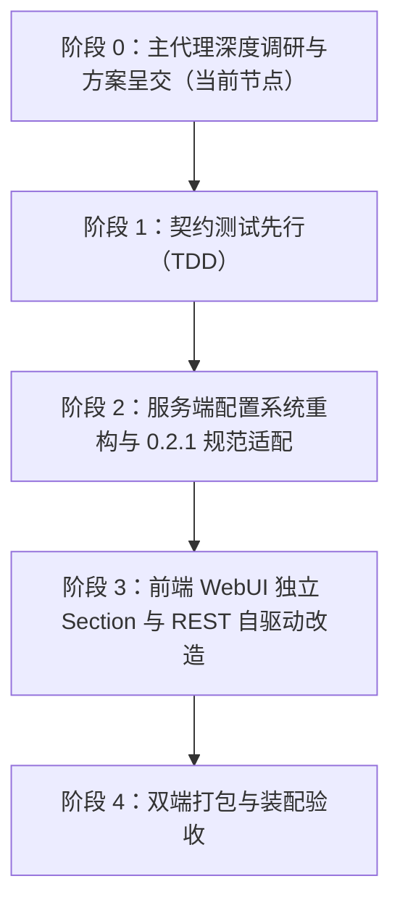

# DeepSeek Harness 0.2.1 更新与 dsh-napcat-bridge 适配深度调研分析

> **文档状态**：调研纪要与方案论证（严格遵守只读与用户决策制，未修改任何业务代码）  
> **调查日期**：2026-10-19  
> **基准版本对比**：DeepSeek Harness `0.1.5-rc.1`（当前项目依赖） ➔ `0.2.1-rc.2`（上游最新发布版）  
> **核心参考工程**：`F:\Project\dsh-qqbot-bridge`（已完成 0.2.0/0.2.1 踩坑与生产落地）

---

## 目录

1. [DSH 0.2.1 核心更新内容剖析（主代理全局核查）](#1-dsh-021-核心更新内容剖析主代理全局核查)
2. [关键问题一：设置项到底放哪？](#2-关键问题一设置项到底放哪)
3. [关键问题二：为什么升级后设置项会为空且保存报错？](#3-关键问题二为什么升级后设置项会为空且保存报错)
4. [关键问题三：旧配置如何平滑迁移？（防死锁与启动阻塞）](#4-关键问题三旧配置如何平滑迁移防死锁与启动阻塞)
5. [前端 WebUI 与 Client 模块的破坏性变更核查](#5-前端-webui-与-client-模块的破坏性变更核查)
6. [Agent 运行时与会话生命周期核查](#6-agent-运行时与会话生命周期核查)
7. [dsh-napcat-bridge 全景整改清单与适配路线规划](#7-dsh-napcat-bridge-全景整改清单与适配路线规划)

---

## 1. DSH 0.2.1 核心更新内容剖析（主代理全局核查）

自本项目依赖的 `0.1.5-rc.1` 以来，DeepSeek Harness 经历了 `0.1.6`、`0.1.7`、`0.2.0` 以及 `0.2.1`（当前最新为 `0.2.1-rc.2`）等重大演进：

### 1.1 插件系统与架构演进
1. **子路径插件规范升级（破坏性调整）**：
   - 子路径插件（如 `<pkg>/client`）**彻底不再读取独立的 package.json**；
   - 国际化文案必须通过 `<subpath>/locale/en.json`（及 `zh.json`）导出，内嵌顶级 `meta` 对象；图标必须通过 `<subpath>/icon` 导出（体积 <= 256 KiB）；
2. **兼容性引擎前置检测**：
   - 引入 `engines.dsh`（如 `"dsh": ">=0.2.0"`），插件市场与 Loader 优先根据此字段判断兼容性；
3. **彻底移除 Invariant 诊断插件**：
   - 移除了各包的 `./invariant` 导出；
4. **插件 Session 状态记录接口**：
   - 新增 `appendPluginRecord` / `pluginRecordOf`，支持插件在 Session 日志中写入自己的事件，且标记为 `ignorable`，不占用模型 Prompt Token，随会话持久化与迁移；
5. **设置系统由单文件转向 Profile Patch 体系**：
   - 彻底淘汰了 0.1.5 时代的 `settings.yaml`，收拢为多 Profile Patch 体系（`cordis.patch.yml`）；
   - 服务端彻底移除 `ctx.settings.installSection()`；客户端沙箱中彻底移除了 `settingsScope` 服务；
   - 引入了 Schemastery `.volatile()` 即时更新与 `.role('secret')` 凭据脱敏管理。

### 1.2 前端与客户端交互
1. **设置弹窗重构为侧边栏独立页面（Section Page）**：
   - 官方设置窗口由旧版插件折叠列表改为带左侧导航的独立页面体系（`settings.section` 插槽）；
2. **Primitives 图标库全面重构**：
   - 废弃并删除了固定像素尺寸后缀命名（如 `IconChevronDownOutline14`），全面重构为以字重命名的 `IconChevronDownOutlineRegular` 与 `IconChevronDownOutlineMedium`；
3. **输入区扩展位细分**：
   - 旧版 `conversation.composer.stats` 拆分为 `activity` 与 `usage`，新增 `conversation.input.model.label` Slot；
4. **桌面端与 Web 端双端归一**：
   - 无论 Web 还是 Electron Desktop（`desktop-host`），前端均由 `@deepseek-ai/dsh-client-modules` 统一扫描并组装，要求相同的 lazy-CJS 模块工厂规范。

---

## 2. 关键问题一：设置项到底放哪？

### 2.1 现状与痛点
当前 `dsh-napcat-bridge` 在 `src/client/index.tsx` 中注册的是旧版插件堆叠插槽：
```tsx
// 当前问题代码 (src/client/index.tsx:350-359)
ctx.slots.inject('settings.plugin.item', function* () {
  yield ctx.slots.register(
    {
      name: 'settings.plugin.item',
      key: 'dsh-napcat-bridge',
      inject: () => buildSettingsBridge(ctx, SETTINGS_NAMESPACE),
    },
    NapCatSettingsCard
  );
});
```
在 DSH 0.2.0/0.2.1（特别是官方桌面端与 DSH Market）中，`settings.plugin.item` 属于已边缘化/废弃的折叠卡片插槽。如果仅注入此插槽，在 0.2.x 客户端中该设置项**要么根本找不到，要么深埋在二级抽屉中，完全无法与官方成熟插件对齐**。

### 2.2 0.2.1 最佳实践：注册到侧边栏独立页面（`settings.section`）
对照 `dsh-qqbot-bridge`（Commit `eb507c9` & `35e192a`），成熟插件应作为**独立设置板块（Section Page）**对齐侧边栏规范：

```tsx
// 推荐规范实现 (src/client/index.tsx)
ctx.slots.inject('settings.section', () => {
  return ctx.slots.register(
    {
      name: 'settings.section',
      id: 'napcat',                    // 侧边栏唯一路由 ID（URL hash 与激活状态）
      order: 55,                       // 排序权重：置于核心内置项下方、普通项上方
      label: () => 'QQ NapCat',        // 侧边栏展示文案（返回 string 的函数）
      locale: SETTINGS_NAMESPACE,      // 绑定的国际化/命名空间 ('dsh-napcat-bridge')
      inject: () => ({}),              // 属性注入（REST 架构下传空对象）
    },
    NapCatSettingsSection              // 顶层 Section 页面组件
  );
});
```

### 2.3 容器与布局改造
1. **支持 Section 全高布局模式**：
   - 废除顶层折叠箭头与 Chevron 按钮，主页面呈现为 `h2` 标题、简介描述、Tab 切换栏与表单主体；
   - 底部提供保存与放弃修改操作栏；
2. **样式补齐**：
   - `src/client/card-styles.ts` 中需补齐 `.napcat_section`、`.napcat_sectionHead`、`.napcat_sectionBody` 等 Flex 全高样式。

---

## 3. 关键问题二：为什么升级后设置项会为空且保存报错？

### 3.1 客户端沙箱中 `settingsScope` 蒸发（致命原因）
当前 `src/client/index.tsx` 的 `buildSettingsBridge` 完全建立在 `ctx.settingsScope` 上：
```ts
// 当前问题代码 (src/client/index.tsx:19-57)
export function buildSettingsBridge(ctx: any, namespace: string = SETTINGS_NAMESPACE) {
  const describe = ctx.settingsScope?.describe?.() ?? null;
  const scope = ctx.settingsScope?.bind?.({ namespace }) ?? null;
  ...
  return {
    get initialConfig() {
      return readNamespace()?.value ?? {}; // describe 恒为 null，始终返回 {}！
    },
    onSaveSettings: async (...) => {
      const targetScope = scope ?? ctx.settingsScope?.bind?.({ namespace }) ?? ctx.settingsScope;
      if (!targetScope?.mutate) throw new Error('settings API 不可用'); // 必然抛错！
    }
  };
}
```
**根因剖析**：
1. **`settingsScope` 在 0.2.0/0.2.1 客户端中被彻底删除**！`ctx.settingsScope` 始终为 `undefined`；
2. 导致 `readNamespace()` 永远拿不到数据，`initialConfig` 恒为空对象 `{}`，打开设置面板时所有输入框被空白/默认值覆盖；
3. 用户点击保存时，`targetScope?.mutate` 为空，直接抛出 `Error: settings API 不可用`；
4. 甚至由于 `src/client/index.tsx` 静态声明了 `export const inject = [..., 'settingsScope']`，在 Cordis 依赖解析规则下，由于缺失 `settingsScope` 服务，**整个客户端插件甚至根本无法激活（Fiber 保持 INACTIVE）**！

### 3.2 终极解决方案：REST 自驱动架构（对标 `dsh-qqbot-bridge` 35e192a）
为彻底解耦 DSH 客户端私有 API 的变动风险，成熟插件架构采用 **REST 自驱动模式**：
- **前端彻底解耦**：前端 UI 不依赖任何客户端 settings 服务，`inject` 仅需 `['slots', 'sessions']`；
- **服务端挂载标准 HTTP 路由**：服务端通过稳定的 `ctx.get('webServer')` 注册 `/plugins/dsh-napcat-bridge/config`（GET 读取，POST 保存）；
- **服务端完成持久化与热生效**：服务端持有完整的 Cordis 权限，调用服务端的 `settings.mutate` 写入当前 Profile，并直接触发进程内网关热对齐（`queueReconcile`）；
- **凭据脱敏与防误清空**：
  - GET 时：若 `ws_token` 存在，服务端返回 `{ ok: true, hasSecret: true, config: { ...cfg, ws_token: '' } }`（真实密钥绝不传给前端）；
  - 前端回显：占位符显示 `"已配置，重新输入以替换 Token"`，输入框类型设为 `password`；
  - POST 时：若用户未修改 token，前端不提交该字段；服务端二次设防，若提交空串则自动保留当前已有真实 Token，除非用户显式点击「重置为默认」。

---

## 4. 关键问题三：旧配置如何平滑迁移？（防死锁与启动阻塞）

### 4.1 存储机制变迁与候选文件探测
- **0.1.5**：配置保存在 `~/.dsh/settings.yaml`；
- **0.2.0/0.2.1**：DSH 启动时将 `settings.yaml` 单向导入 Profile Patch 并立即重命名为 `settings.yaml.imported`；
- **必要对策**：必须实现 `readLegacyConfig(dshHome)`，同时探测 `settings.yaml` 与 `settings.yaml.imported`。若当前 Profile 尚未写入配置，先同步从旧文件读取内存配置，保证 WebSocket 服务端能毫秒级启动上线，避免停机等待迁移。

### 4.2 桌面端 Boot 阶段死锁根因（Commit `5b08ca6` 的惨痛教训）
- **死锁场景**：
  如果在插件的 `apply()` 同步主干道上直接调用 `settingsService.update(SETTINGS_NAMESPACE, legacyValues)`：
  1. 官方桌面端（Electron `desktop-host`）启动时，Cordis Loader 正在加锁执行所有插件的 `apply`；
  2. 此时调用 `settingsService.update()` 会修改 patch 并试图触发 Loader 的重新加载/重算事件；
  3. 但 Loader 此时正同步等待插件 `apply()` 返回，无法响应重载；
  4. 而 `update()` 返回的 Promise 在等待 Loader 确认事件落地，双方陷入死锁！
  5. **现象**：桌面端启动卡死，窗口长时间停留在白屏或加载中，应用彻底不可用！
- **防御铁律**：
  1. **生命周期延后**：必须监听 `(ctx as any).on('ready', () => { void migrateLegacyConfig(ctx, config); })`，在全系统就绪后异步触发；
  2. **加设 3 秒硬超时**：通过 `Promise.race` 对 `settingsService.update` 施加 3 秒超时限制，超时则放弃等待；
  3. **幂等性防护**：设置模块级 `migrationExecuted` 标记，仅执行一次，防止反复重试造成事件风暴。

---

## 5. 前端 WebUI 与 Client 模块的破坏性变更核查

| 变更项 | 现状与风险 | 0.2.1 规范要求与适配方案 |
|---|---|---|
| **子路径插件元数据** | `exports` 仅暴露 `./client`，无 `locale` 和 `icon`；0.2.1 禁读子路径 `package.json` | 补齐 `locale/en.json`、`locale/zh.json` 与 `icon`（<=256KB），并在 `exports` 中显式暴露 |
| **Primitives 图标缺失** | `src/client/card.tsx:2` 硬编码引入 `IconChevronDownOutline14`；**该图标在 0.2.1 中已被彻底删除**，运行时必抛 `Element type is invalid`，导致整个设置弹窗白屏崩溃！ | 引入别名兼容解析器 `resolveChevronDownIcon()`，并在顶层包装 `SectionErrorBoundary` 防白屏 |
| **ModuleLoader ID** | `scripts/build-client.ts` 生成的模块 ID 为 `"dsh-napcat-bridge/client"` | 0.2.x 客户端 Loader 习惯按主包名索引，统一改为 `"dsh-napcat-bridge"` |
| **输入框隐藏器作用域** | `QQComposerHider` 渲染裸样式 `[data-composer-card] { display: none !important; }`，缺乏作用域限定，极端情况下可能污染其他非 QQ 会话 | 局部样式选择器增加 `body[data-dsh-napcat-readonly="true"]` 复合前缀，双重互锁 |

---

## 6. Agent 运行时与会话生命周期核查

经过对 `scratch/dsh-0.2.1-pkgs` 下 `dsh-agent` 和 `dsh-session` 声明文件与源码的深度逐行核验：

1. **Agent 核心生命周期接口完全兼容**：
   - `AgentHandle` 接口依然保持 `{ agent: Agent; dispose(): Promise<void> }`；
   - `ctx.agents.get(sessionId)` 依然返回 bare `Agent`（不含 `handle`）；
   - 在我们最近一次提交（`a307b8f`）中将 `getOrCreateAgent` 修复为**纯复用 + 官方 `followup` 串行排队**，完全符合 0.2.1 规范！
2. **出站流式事件结构 100% 保持稳定**：
   - `src/outbound/stream.ts` 监听的 `turn/start`、`turn/end`、`agent/assistant-stream`、`assistant/message` 等事件字段在 0.2.1 中未发生任何结构变化，前向兼容良好；
3. **Session 状态记录接口（可选用增强）**：
   - 0.2.1 引入了 `appendPluginRecord(session, 'plugin:dsh-napcat-bridge/...', data)`，可在会话日志中自包含保存 QQ Peer 元数据，增强独立恢复能力。

---

## 7. dsh-napcat-bridge 全景整改清单与适配路线规划

为了让项目稳健平滑升级到 DSH 0.2.1 体系，建议分为以下 4 个阶段有序推进（TDD 契约先行，严禁拍脑袋）：



### 整改任务包概览：
1. **任务包 A：服务端配置与迁移重构**
   - 移除 `src/index.ts` 中已废弃的 `installSection`；
   - 新增 `src/server/routes.ts`，挂载 `/plugins/dsh-napcat-bridge/config` REST 路由；
   - 新增 `src/config/migrate.ts`，实现带超时的异步静默迁移与同步读取兜底；
   - 改造 `src/config/schema.ts`，字段补充 `.volatile()` 与 `ws_token` 的 `.role('secret')`；
2. **任务包 B：客户端 WebUI 与 Section 重构**
   - 改造 `src/client/index.tsx`：清除 `settingsScope`，改挂 `settings.section`；
   - 改造 `src/client/card.tsx`：实现 REST 自驱动加载/保存、Secret 脱敏占位、Chevron 图标别名兼容与 `SectionErrorBoundary`；
   - 补齐 `src/client/card-styles.ts` 中的 Section 布局样式；
   - 更新 `scripts/build-client.ts` 模块 ID 为 `"dsh-napcat-bridge"`；
3. **任务包 C：工程配置与元数据对齐**
   - `package.json` 增加 `engines.dsh: ">=0.2.0"`；
   - 补齐 `locale/en.json`、`locale/zh.json` 与子路径导出；
   - 更新 devDependencies/peerDependencies 对齐 0.2.x。

---

> 报告编制：Antigravity 主代理与子代理集群  
> 归档路径：`docs/调研纪要-DeepSeek_Harness_0.2.1升级与项目适配深度分析.md`
