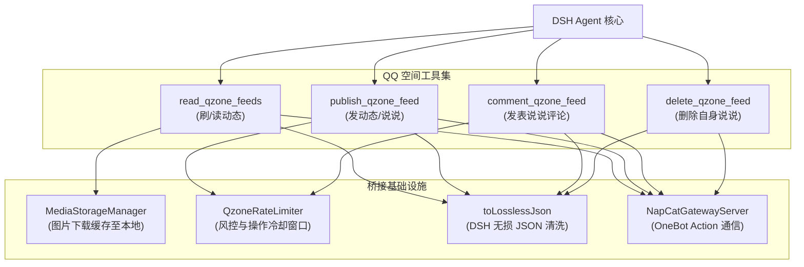

# 需求文档：QQ 空间动态互动工具集（读动态 · 发说说 · 评动态 · 删动态）

> **项目**: dsh-napcat-bridge  
> **文档版本**: v1.1（基于 SnowLuma 2.4.0 真机实测确证契约更新）  
> **状态**: 待用户最终确认执行  
> **相关模块**: `src/tools/`, `src/types/`, `src/gateway/server.ts`, `src/storage/media.ts`

---

## 0. 背景与目标

当前 `dsh-napcat-bridge` 的交互场景主要聚焦在 QQ 单聊与群聊的“即时消息对话”维度。虽然已具备历史记录检索（`read_chat_history`）、文件收发（`send_file`）、表情回应（`react_message`）以及定时任务调度（`scheduler`）等能力，但 Agent 仍缺乏在 **QQ 社交圈（QQ 空间 / QZone）** 中的感知与表达通道：

1. **社交圈感知缺失**：Agent 无法主动获取好友的日常生活动态或分享的照片，在开启话题时无法结合好友近期动态产生共鸣；
2. **主动分享缺位**：Agent 具备定时任务与记忆沉淀能力，但无法将一天的见闻、生成的绘画或总结性思考以“发布动态”的形式对外展示；
3. **互动形式单一**：无法参与好友说说的点赞与评论互动，限制了拟人化好友的人格真实感；
4. **历史自省与清理能力**：当 Agent 发布了测试性动态、冗余动态或黑历史时，需要有自主删除与撤回自身动态的能力。

**核心目标**：  
基于经真机严格实测验证的 OneBot 11 空间扩展 Action，设计并落地 **4 个高可用、高契约安全度的 Agent 工具**（读动态、发动态、评动态、删动态），并配套完善的多模态图片本地缓存、Token 上下文风控控制与操作频率保护机制。

---

## 1. 协议底座与真机验证基线

经真实环境（`SnowLuma v2.4.0-node (OneBot v11)`，反向 WebSocket，Bearer Token 认证）实测探测与真机客户端查验，确证以下协议底座事实：

| 功能操作 | 协议端 Action | 实测状态 | 核心参数与行为 |
| :--- | :--- | :---: | :--- |
| **刷好友动态** | `get_qzone_feeds` | ✅ 验证通过 | `{ attach_info?: string }`<br/>协议端直接上报已结构化解析的 `tid`、`uin`、`nickname`、`content`、`images`、`like_count`、`comment_count` |
| **用户说说列表** | `get_qzone_msg_list` | ✅ 验证通过 | `{ target_uin?: number, num?: number, pos?: number }`<br/>查好友返回结构化 `msglist`；查无说说账号时 `msglist` 为 null（需空数组兜底） |
| **动态详情与评论**| `get_qzone_msg_detail` | ✅ 验证通过 | `{ tid: string, target_uin?: number }`<br/>拉取该动态的深度评论列表 |
| **发布说说** | `send_qzone_msg` | ✅ 验证通过 | `{ content: string, images?: string[], ugc_right?: number }`<br/>真机实测发纯文本和带图动态（`file:///...` 格式），在手机 QQ 端完美渲染，接口返回 `data.tid` 与 `data.time` |
| **删除说说** | `delete_qzone_msg` | ✅ 验证通过 | `{ tid: string }`<br/>真机实测成功物理删除动态，空间瞬间清理无残留 |
| **发表说说评论** | `comment_qzone` | ✅ 验证通过 | `{ tid: string, content: string, target_uin?: number }` |
| **点赞 / 取消赞** | `like_qzone` / `unlike_qzone` | ✅ 验证通过 | `{ tid: string, target_uin?: number }` |
| **编辑说说** | `edit_qzone_msg` | ❌ 不存在 (1404) | QQ 空间底层协议自始至终不支持修改已发布说说（官方客户端与 Web 端亦只能删除后重发） |

---

## 2. 工具集架构与职责分工

为了确保 LLM 在工具选择和参数填入时的准确率，避免由于多意图合一导致参数混乱或必填校验失效，明确拆分为 **4 个职责单一、Schema 严格定义** 的工具：



---

## 3. 工具详细规格设计

### 3.1 工具 1：`read_qzone_feeds`（刷/读动态）

#### 3.1.1 工具定位
只读工具。允许 Agent 查看好友动态流、指定好友的历史动态或自身的历史动态。具备图片自动下载本地化（供视觉多模态分析）与评论摘要能力。

#### 3.1.2 输入参数（Params Schema）
```typescript
interface ReadQzoneFeedsParams {
  /**
   * 查看范围
   * - 'friends': 默认值，查看好友动态流（类似于手机 QQ 空间主页）
   * - 'self': 查看机器人/当前登录账号自己发表的历史动态
   * - 'user': 查看指定某个 QQ 好友的历史动态
   */
  scope?: 'friends' | 'self' | 'user';

  /**
   * 目标用户的 QQ 号。当 scope 为 'user' 时必填；为 'friends' 或 'self' 时自动忽略
   * 支持数字或纯数字字符串格式
   */
  target_qq?: string | number;

  /**
   * 获取动态条数。默认 5 条，最小 1 条，最大限制 10 条（严格防止上下文膨胀）
   */
  limit?: number;

  /**
   * 分页偏移量（起始位置），默认为 0。用于连续翻页查看
   */
  offset?: number;
}
```

#### 3.1.3 返回数据（Result Schema）
```typescript
interface QzoneImageItem {
  url: string;             // 远端原始图片 URL
  local_path?: string;     // 本地缓存绝对路径（由 MediaStorageManager 自动下载落盘），供视觉多模态消费
}

interface QzoneCommentItem {
  comment_id: string;      // 评论唯一 ID
  author: {
    user_id: number;       // 评论者 QQ 号
    nickname: string;      // 评论者昵称
  };
  content: string;         // 评论内容
  create_time: string;     // 格式化时间字符串
  is_self: boolean;        // 是否为当前登录 AI 账号自身发表的评论
}

interface QzoneFeedItem {
  feed_id: string;         // 动态唯一 ID (tid)
  author: {
    user_id: number;       // 发布者 QQ 号
    nickname: string;      // 发布者昵称
  };
  publish_time: string;    // 发布时间文本（如 "2026-11-04 10:30:00"）
  content: string;         // 动态正文文本
  images: QzoneImageItem[];// 图片附件列表（包含 url 与 local_path）
  comments: QzoneCommentItem[]; // 评论区精简摘要（限最新前 3~5 条高价值评论）
  total_comment_count: number;  // 该动态总评论数
  like_count?: number;     // 点赞数量
}

interface ReadQzoneFeedsResult {
  success: boolean;
  scope: 'friends' | 'self' | 'user';
  feeds: QzoneFeedItem[];
  has_more: boolean;       // 是否仍有更早的动态
  next_offset?: number;    // 下一页的建议 offset
  message?: string;        // 辅助说明或异常提示
}
```

---

### 3.2 工具 2：`publish_qzone_feed`（发动态/说说）

#### 3.2.1 工具定位
写入工具。允许 Agent 发布带有文字正文与图片附件的 QQ 空间说说。

#### 3.2.2 输入参数（Params Schema）
```typescript
interface PublishQzoneFeedParams {
  /**
   * 动态文字正文（必填）
   */
  content: string;

  /**
   * 图片附件路径或 URL 列表（可选）
   * 支持：
   * 1. 绝对文件路径（如 DSH 沙箱生成图、表情包库绝对路径、本地图片绝对路径）
   * 2. file:// URI 协议路径
   * 3. HTTP/HTTPS 网络图片 URL
   * 桥接内部自动校验存在性并转换为协议端支持的上传格式
   */
  images?: string[];
}
```

#### 3.2.3 返回数据（Result Schema）
```typescript
interface PublishQzoneFeedResult {
  success: boolean;
  feed_id?: string;        // 发布成功后的动态 ID（tid）
  message: string;         // 发布结果描述（例如 "动态发布成功" 或 拦截错误原因）
}
```

---

### 3.3 工具 3：`comment_qzone_feed`（发表说说评论）

#### 3.3.1 工具定位
互动写入工具。允许 Agent 在指定的说说下方发表评论。

#### 3.3.2 输入参数（Params Schema）
```typescript
interface CommentQzoneFeedParams {
  /**
   * 目标动态唯一 ID (tid，必填)
   */
  feed_id: string;

  /**
   * 目标说说发布者的 QQ 号（必填，底层 QZone 路由协议关键定位参数）
   * 支持数字或纯数字字符串格式
   */
  target_qq: string | number;

  /**
   * 评论文字正文（必填）
   */
  content: string;
}
```

#### 3.3.3 返回数据（Result Schema）
```typescript
interface CommentQzoneFeedResult {
  success: boolean;
  comment_id?: string;     // 评论成功后的 comment ID（若协议端返回）
  message: string;         // 结果状态说明
}
```

---

### 3.4 工具 4：`delete_qzone_feed`（删除自身说说）

#### 3.4.1 工具定位
写入与清理工具。允许 Agent 删除自己发表过的某条说说（按 `feed_id`/`tid`）。

#### 3.4.2 输入参数（Params Schema）
```typescript
interface DeleteQzoneFeedParams {
  /**
   * 欲删除的动态唯一 ID (tid，必填)
   * 来源于 publish_qzone_feed 的返回值或 read_qzone_feeds 查询结果
   */
  feed_id: string;
}
```

#### 3.4.3 返回数据（Result Schema）
```typescript
interface DeleteQzoneFeedResult {
  success: boolean;
  feed_id: string;
  message: string;         // 例如 "动态已成功删除" 或 "删除失败: ..."
}
```

---

## 4. 关键工程联动与系统保障

### 4.1 多模态图片本地化流水线
- **现状机制**：DSH 运行时查看图像多模态输入时，最可靠的形式是本地文件路径；
- **执行逻辑**：
  1. `read_qzone_feeds` 收到协议端解析出的图片 URL 列表；
  2. 调用桥接现有的 `mediaManager.downloadAndCacheMedia(url, 'image')` 异步并发下载并缓存至本地临时目录（默认 10 秒超时保底）；
  3. 成功下载的项填充 `local_path`，若下载失败则保留原始 `url`，确保工具平稳容错。

### 4.2 本地图片与 URI 自动转换流水线
- **发布动态时**：Agent 传入的 `images` 可能是本地存储路径（如 `D:/mock/images/sample.png` 或 `/data/images/sample.png`）、沙箱生成路径或网络图；
- 桥接内部工具层做统一规范化：若是本地文件绝对路径，自动转换为标准 `file:///...` 协议格式发送给协议端（实机已验证协议端对 `file:///` 格式的处理最为顺畅且稳定）。

### 4.3 上下文与 Token 膨胀控制
- **保护措施**：
  1. `limit` 强制设定硬上限：最高不得超过 10 条，缺省默认 5 条；
  2. 评论区做精简截断：每条说说至多保留最新的 3~5 条评论；
  3. 优先标记并保留 `is_self === true` 的评论，让 Agent 清楚知道自己是否已经回复过该动态，避免重复评论。

### 4.4 腾讯空间风控与速率限制（Rate Limiting）
- **风险分析**：QQ 空间接口的风控严苛程度高于即时消息。高频连续调用 `send_qzone_msg` 或 `comment_qzone` 极易触发腾讯滑块验证码或 `network busy` 封禁；
- **防范策略**：
  1. **发布动态冷却**：同一机器人账号两次发布动态之间强制设置 **冷却时间**（默认 60 秒）；
  2. **发表评论冷却**：同一机器人账号发表评论强制设置 **冷却时间**（默认 15 秒）；
  3. **冷却未满直接拦截**：若 Agent 短时间内再次发起写操作，工具内部直接拦截并返回 `success: false, message: "空间操作过于频繁，处于冷却保护中，请在 X 秒后再试"`，彻底防止把请求发到腾讯端导致风控。

### 4.5 DSH Lossless JSON 输出红线
- 严格贯彻项目 `AGENTS.md` 第 6 条规定：
  - 严禁向 DSH 返回包含 `undefined` 字段的对象；
  - 所有工具在 `execute` 返回前，统一使用 `toLosslessJson()` 递归清洗；
  - 契约测试中必须包含深度断言：所有返回键值绝无 `undefined`。

---

## 5. 推进计划与落地步骤（TDD 标准流程）

| 步骤 | 任务目标 | 核心产出物 | 验证手段 |
| :--- | :--- | :--- | :--- |
| **Step 1: 契约测试先行 (TDD)** | 编写 4 个工具的契约测试与 Lossless JSON 深度校验断言 | `test/qzone-tools.spec.ts` | 运行 `vitest run test/qzone-tools.spec.ts`，测试正当呈红状态 |
| **Step 2: 类型定义与模块实现** | 新增 Qzone 类型定义与工具实现文件，包含冷却限制与图片下载接线 | `src/types/index.ts`<br/>`src/tools/qzone.ts` | 编写完整业务逻辑与参数校验 |
| **Step 3: 装配接线与转绿验证** | 在 `src/tools/index.ts` 注册 4 个工具声明与执行闭环 | `src/tools/index.ts` | 契约测试 100% 自然转绿并通过类型检查 |
| **Step 4: 生产编译与真机交付核查** | 执行 `pnpm build` 并核验 `dist/`，进行真机全功能闭环验证 | `dist/` 编译产物<br/>Git Commit | 真实生产路径可达与无任何未接线缺口 |
