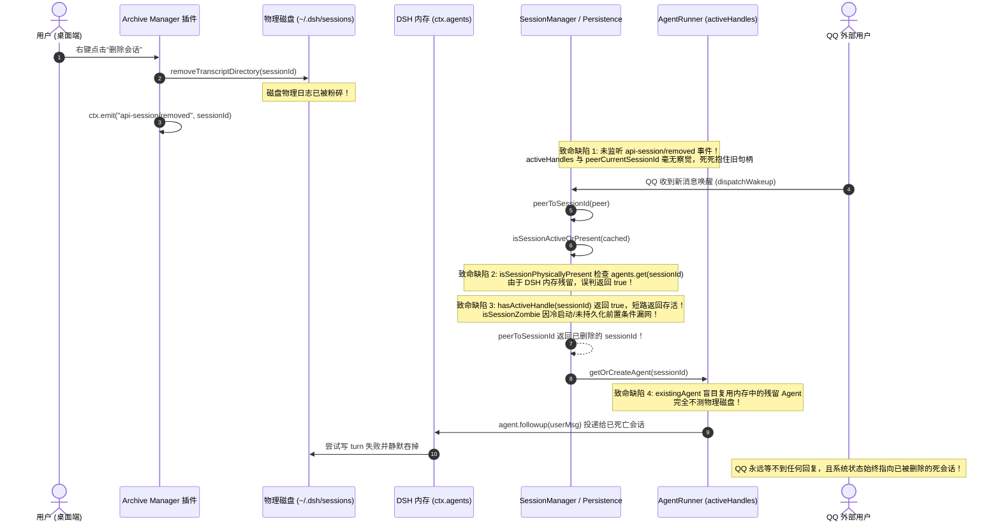
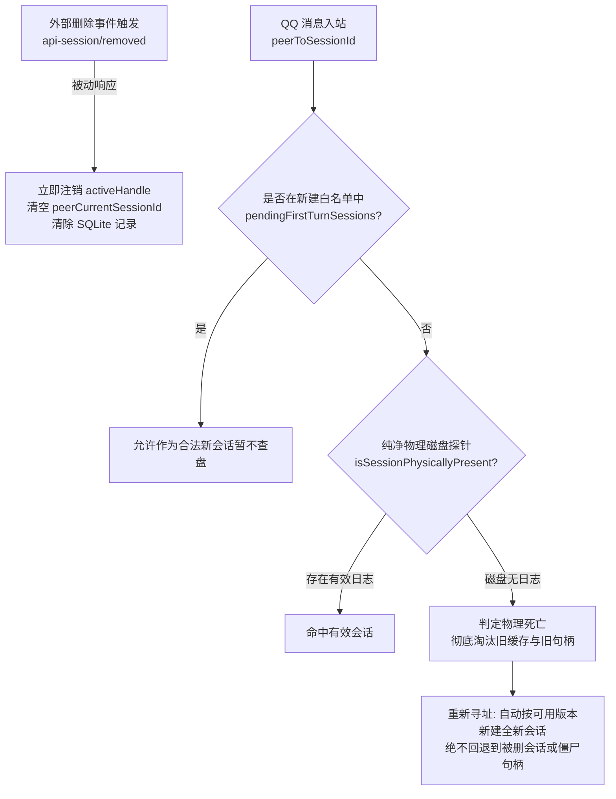

# 根因深度分析与综合解决方案：会话删除后来消息仍指向已删除会话缺陷考证

- **日期**：2026-10-22
- **责任模块**：`src/gateway/session.ts`、`src/gateway/session/persistence.ts`、`src/gateway/session/agent-runner.ts`
- **关联依赖与插件**：
  - DeepSeek Harness 内核（`@deepseek-ai/dsh-session`、`@deepseek-ai/dsh-agent`、`@deepseek-ai/cordis`）
  - 桌面端会话管理插件 `@michengai/dsh-archive-manager`（Archive Manager）
  - 关联提交：`26d6876`（物理探针初步修复）、`31af43a`（编号防撞）、`a3bf3d8`（新会话回退修复）
- **状态**：根因彻底查明，方案已完备，待用户确认后实施

---

## 1. 问题背景与现状阐明

在用户桌面端环境（`C:\Users\Nyara\.dsh\profiles\desktop`）中，DeepSeek Harness (DSH) 原生并不具备物理删除会话功能（仅提供侧栏“归档”）。会话的物理删除通常是由第三方插件 **`@michengai/dsh-archive-manager` (Archive Manager)** 注入并管理的。

在最近的提交中，系统先后尝试修复了两个问题：
1. `26d6876`：修复桌面端删除会话后需重启 DSH 才能新建会话的缺陷；
2. `a3bf3d8`：修复 QQ 发送 `/新建` 后新会话因落盘延迟被误判为物理不存在、进而导致重复编号并回退旧会话的缺陷。

然而，**在提交 `a3bf3d8` 之后，“删除一个会话后，如果这个时候来消息会导致指向那个已经删除的会话”的 Bug 并没有完全修好**。当用户在桌面端通过 Archive Manager 删除了某 QQ 会话后，QQ 侧一旦有新消息到达，消息依然会被拽回那个已经删除的会话，或者由于向僵尸 Agent 投递消息导致 QQ 端永远收不到回复。

---

## 2. 跨系统机制与组件全景探查

### 2.1 Archive Manager (`@michengai/dsh-archive-manager`) 的删除实现机制
通过探查 `~/.dsh/profiles/desktop/node_modules/@michengai/dsh-archive-manager/lib/workspace.js`：
当用户在桌面端侧边栏右键点击“删除会话”时，插件执行了 `deleteSessionCore(sessionId)`：

```javascript
// Archive Manager 核心删除逻辑 (workspace.js)
async deleteSessionCore(sessionId, descendantHeaders) {
  const sessions = this.ctx.get("sessions");
  const live = sessions?.get(sessionId);
  if (live !== void 0) {
    await sessions.flush(live);
    const entry = sessions.liveEntryFor(live);
    sessions.detachEntered(entry); // 1. 从 sessions 服务 detach
  }
  const projCache = this.ctx.get("sessionProjectionCache");
  if (projCache !== void 0) await projCache.delete(sessionId); // 2. 清理投影缓存
  await this.deleteDescendants(sessionId, descendantHeaders);   // 3. 级联清理子代理
  await this.cleanSpill(sessionId);                           // 4. 清理 spill 目录
  await this.removeTranscriptDirectory(sessionId);            // 5. 物理删除磁盘日志文件目录！
  await this.removeFromWorkspaceAccounts(sessionId);          // 6. 从工作区记账移除
  this.forgetIndexedSession(sessionId);
  this.publishDeletedSession(sessionId);                      // 7. 广播事件
  return { deleted: true };
}

publishDeletedSession(sessionId) {
  try {
    this.ctx.emit("api-session/removed", sessionId);          // ⚠️ 关键广播事件
  } catch (error) { ... }
}
```

**关键技术事实**：
1. **物理日志已被销毁**：`removeTranscriptDirectory` 彻底删除了该会话在磁盘上的 `session.v4.jsonl.zstd` 等日志文件；
2. **广播事件已发出**：Archive Manager 在 cordis 总线上广播了 `this.ctx.emit("api-session/removed", sessionId)`；
3. **未触碰与无法触碰 DSH `ctx.agents`**：Archive Manager 仅与 `sessions`、`projectionCache` 和文件系统交互，**完全没有清理、也无法清理 DSH 内核 `ctx.agents` 集合中残留的 `Agent` 实例**；更不可能直接跨插件清理 NapCat Bridge 内部持有的私有 `activeHandles`！

---

### 2.2 DeepSeek Harness 内核机制
1. **`sessions` vs `agents` 的职责分离**：
   - `sessions` 服务维护会话的事件日志与存储挂载，提供了 `session/disposed` 事件；
   - `agents` 服务维护内存中的 Agent 执行体（包含 AgentLoop、Tool 状态等）。Agent 在创建后若未被显式调用 `handle.dispose()`，其实例依然挂在 `agents` 服务内存中；
2. **写入失败静默吞异常**：
   - 当底层磁盘目录或转录文件被删除后，若外部仍向内存中的 Agent 投递 `agent.followup(userMsg)`，AgentLoop 在尝试将 turn 写入磁盘时会触发底层 `ENOENT` 异常；
   - 该异常在 AgentLoop 内部被静默捕获，导致出站事件永远无法触发，QQ 表现为“死寂”。

---

### 2.3 dsh-napcat-bridge 内部的缺陷交织分析

结合最新代码剖析，为什么上次提交没有修好？为什么删除后仍指向已删除会话？



具体代码证据剖析：

#### 证据 1：`isSessionPhysicallyPresent` 存在致命内存短路（假阳性）
- **代码位置**：[`src/gateway/session/persistence.ts:55-72`](file:///f:/Project/dsh-napcat-bridge/src/gateway/session/persistence.ts#L55-L72)
```typescript
  public isSessionPhysicallyPresent(sessionId: string): boolean {
    // 0. 优先检查进程内存中的活跃会话或 Agent（DSH 0.2.x 延迟落盘保护，防止 live 会话因未写盘被误判死亡）
    const sessions = this.ctx?.get?.('sessions') || (this.ctx as any)?.sessions;
    if (sessions && typeof sessions.get === 'function') {
      try {
        const live = sessions.get(sessionId);
        if (live !== undefined) return true;
      } catch {}
    }

    const agents = this.ctx?.get?.('agents') || (this.ctx as any)?.agents;
    if (agents && typeof agents.get === 'function') {
      try {
        const liveAgent = agents.get(sessionId);
        if (liveAgent !== undefined) return true; // ⚠️ 致命漏洞：直接返回 true
      } catch {}
    }
    ...
```
**原因**：
为了解决“新建会话未落盘被误杀”，上个提交直接在 `isSessionPhysicallyPresent` 开头加入了 `agents.get(sessionId)` 判断。  
但当 Archive Manager 删除了物理磁盘文件时，DSH 的 `ctx.agents` 集合里的 Agent 尚未被清理。`isSessionPhysicallyPresent` **坚定地向全系统撒谎说该会话物理存在**！

#### 证据 2：`isSessionActiveOrPresent` 盲目信任 `hasActiveHandle`
- **代码位置**：[`src/gateway/session.ts:155-161`](file:///f:/Project/dsh-napcat-bridge/src/gateway/session.ts#L155-L161)
```typescript
  public isSessionActiveOrPresent(sessionId: string): boolean {
    if (this.isSessionArchived(sessionId)) return false;
    if (this.agentRunner.isSessionZombie(sessionId)) return false;
    if (this.isSessionPhysicallyPresent(sessionId)) return true;
    if (this.agentRunner.hasActiveHandle(sessionId)) return true; // ⚠️ 致命漏洞：直接返回 true
    return false;
  }
```
**原因**：
NapCat 自身在内存里持有 `this.activeHandles`。当会话在桌面端被删除时，NapCat 内存完全不知情，`hasActiveHandle` 始终为 `true`。只要该会话此前聊过天，`isSessionActiveOrPresent` **直接短路返回 true**，`peerToSessionId` 就会无条件将路由指向这个已经被删除的会话！

#### 证据 3：`isSessionZombie` 存在前置条件盲区
- **代码位置**：[`src/gateway/session/agent-runner.ts:68-70`](file:///f:/Project/dsh-napcat-bridge/src/gateway/session/agent-runner.ts#L68-L70)
```typescript
  public isSessionZombie(sessionId: string): boolean {
    return this.persistedSessions.has(sessionId) && !this.persistence.isSessionPhysicallyPresent(sessionId);
  }
```
**原因**：
它必须满足 `this.persistedSessions.has(sessionId)`。如果会话是从 SQLite 冷加载恢复、或者尚未在运行时执行到 `persistedSessions.add`，该条件为 `false`，导致僵尸会话根本无法被标记为僵尸！

#### 证据 4：`getOrCreateAgent` 盲目复用 `existingAgent`
- **代码位置**：[`src/gateway/session/agent-runner.ts:219-224`](file:///f:/Project/dsh-napcat-bridge/src/gateway/session/agent-runner.ts#L219-L224)
```typescript
    const existingAgent = agents?.get?.(sessionId as any);
    if (existingAgent && !this.persistence.isSessionArchived(sessionId)) {
      (existingAgent as any).modelSelection = selectionRef;
      this.updateSessionTitle((existingAgent as any).session, peer, sessionId);
      return existingAgent; // ⚠️ 完全不确认物理文件在不在，直接复用已死亡的 Agent
    }
```
**原因**：
若会话被删除，`existingAgent` 只要在内存中且未归档，代码连一次磁盘探针都不调，直接把消息塞入已经没有物理底层支撑的僵尸 Agent。

#### 证据 5：对外部删除事件完全缺失感知
Archive Manager 明确广播了 `this.ctx.emit('api-session/removed', sessionId)`，而 Bridge 内部没有任何地方去订阅和响应这个事件。

---

## 3. 根本性解决方案设计

为彻底根治“删除会话后来消息仍指向已删除会话”以及“新建会话落盘延迟被误退旧会话”的矛盾，必须建立**事件响应 + 纯净探针 + 新建白名单保护 + 寻址自动迭代**的四重闭环架构：



### 3.1 方案细则

1. **响应式事件总线对接（Event-Driven Invalidation）**：
   - 在 `SessionManager` 初始化时，向 cordis 注册事件监听：
     ```typescript
     this.ctx.on('api-session/removed', (sessionId: string) => {
       this.handleSessionRemoved(sessionId);
     });
     this.ctx.on('session/disposed', (session: any) => {
       if (session?.id) this.handleSessionRemoved(String(session.id));
     });
     ```
   - 当监听到会话被删除时：
     - 调用 `agentRunner.releaseActiveHandle(sessionId)` 释放内核锁与上下文；
     - 清除 `peerCurrentSessionId` 与 `pendingClearedSessionId` 中对应的条目；
     - 联动更新 SQLite 将 `current_session_id` 置空；
     - 记录该 sessionId 到本地已删除集合中。

2. **纯净化物理磁盘探针（Pure Physical Disk Probe）**：
   - 彻底重构 `isSessionPhysicallyPresent(sessionId)`：
     - **严禁**检查 `ctx.agents` 或 `ctx.sessions` 等内存对象；
     - **严禁**检查 `activeHandles.has`；
     - 严格以 `sessionPersistence.locate` 路径或 `~/.dsh/sessions/` 物理目录下的真实有效日志文件（`session.v4.jsonl.zstd`、`session.v3.jsonl.zstd` 等）为物理存在的唯一凭据。

3. **显式分离“新建待写保护”与“物理存活性”（Creation Window Protection）**：
   - 引入显式的生命周期集合：`pendingFirstTurnSessions = new Set<string>()`；
   - 只有在当前进程主动调用 `agents.create` 新建会话时，才将该会话临时加入白名单；
   - 一旦该会话首次完成落盘或检测到磁盘日志文件产生，立即从白名单移出；
   - 若被外部删除事件命中，立即从白名单抹除；
   - 这样既彻底保证了刚 `/新建` 的会话在首个 turn 期间不会因落盘延迟被误杀，又杜绝了历史会话被误判存活的问题。

4. **`getOrCreateAgent` 严密的物理存活前置守卫与淘汰自愈**：
   - 在复用任何 `activeHandles` 或 `ctx.agents.get` 之前，必须执行二次物理存活校验：
     ```typescript
     const isAlive = this.persistence.isSessionPhysicallyPresent(sessionId) || this.isPendingFirstTurn(sessionId);
     if (!isAlive) {
       await this.releaseActiveHandle(sessionId);
       this.delegate.onSessionReassigned?.(peer, '');
       sessionId = this.delegate.peerToSessionId(peer); // 重新寻址全新会话
     }
     ```
   - 坚决杜绝把消息塞给任何底盘已被抽空的僵尸 Agent。

5. **`peerToSessionId` 寻址在会话被删后的自愈保证**：
   - 当旧会话被物理删除后，`peerToSessionId` 扫描物理存活的未归档会话；
   - 若该 peer 下没有任何其他存活会话，或原本的最高版本被删除，自动推导生成合法的新 SessionId（例如原会话一被删，重新生成 `#1` 全新会话），确保消息顺畅开启全新对话，绝不卡死。

---

## 4. 验证计划与测试保护

1. **先行编写契约测试**：
   - 模拟在 DSH 运行期间通过 Archive Manager 发送 `api-session/removed` 事件，断言 `SessionManager` 与 `SessionAgentRunner` 内存状态立即被清除；
   - 模拟在会话物理文件被 `rm` 后（即使内存残留 Agent），QQ 新消息进站能准确感知物理死亡、自动淘汰旧句柄并创建全新物理会话；
   - 模拟刚 `/新建` 且未完成首轮落盘的会话在白名单保护下正常处理后续消息，绝不回退；
2. **回归测试全量覆盖**：
   - 运行现有的全部会话契约测试（`session-new-command-persistence.test.ts`、`session-deleted-live-recovery.test.ts`、`session-gap-filling.test.ts` 等），确保 100% 通过；
3. **构建与真机产物对齐**：
   - 运行 `pnpm typecheck` 与 `pnpm build`，确保 `dist/` 编译产物最新生效。
