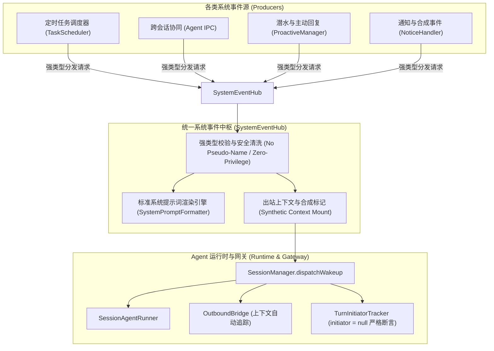

# 方案设计：系统事件与统一唤醒中枢 (SystemEventHub)

> 日期：2026-11-07  
> 状态：方案已确认，开发中  
> 目标：将散落在定时任务、跨 Agent 协同 IPC、潜水唤醒、主动回复及通知系统的各类非外部用户事件收敛，建立统一的系统事件中枢，根治会话标题污染、提示词格式割裂、审批身份越权与出站上下文误判隐患。

---

## 1. 背景与历史回顾

在 `dsh-napcat-bridge` 的演进过程中，Agent 不仅需要响应外部 QQ 用户的真实消息（私聊/群聊 `@`、引用等），还需要响应一系列**非外部输入产生的系统事件**：
1. **定时任务唤醒** (`TaskScheduler`)：定时提醒、周期报告等；
2. **跨 Agent 协同 IPC** (`AgentIPC`)：创建目标 Agent 初始化注入、跨会话协作消息投递；
3. **潜水唤醒与主动回复** (`ProactiveManager`)：超时潜水冒泡 (`idle`)、未回复消息聚合轮询 (`polling`)；
4. **系统协议与通知事件** (`NoticeHandler`)：戳一戳通知 (`notify.poke`)、未来扩展的群事件等。

### 历史踩坑与现状痛点
虽然过去各阶段针对具体问题已完成了临时修复与打补丁，但由于各模块“各自为政”，仍然存在根本性的架构隐患：

1. **会话标题与昵称缓存污染（历史提交 `d6d8db2`、`61b314f`）**：
   - **痛点**：定时任务组装 Payload 时传入 `from_name: '系统定时任务'`，跨 Agent IPC 传入 `from_name: '系统协作总线'` 或 `'协同 Agent'`；
   - **历史修法**：在 [`src/gateway/session/agent-runner.ts`](file:///f:/Project/dsh-napcat-bridge/src/gateway/session/agent-runner.ts) 增加了 `REAL_SENDER_TRIGGERS` 白名单过滤，并在内存中硬编码了 `SYSTEM_SENDER_NAMES = Set(['系统定时任务', '协同 Agent', '系统协作总线', '内部通讯'])` 用于历史污染自愈；
   - **隐患**：这是典型的“下游打掩体”。产生端依然在自由伪造系统名称，一旦未来新增某个系统模块传入了未在黑白名单覆盖内的名称，私聊会话标题将再次被永久改写。

2. **提示词格式散乱、风格不一（历史提交 `10a40ce`）**：
   - **痛点**：早期各模块各自在调用处拼接字符串，格式迥异，有的带时间戳、有的不带，有的遗漏了 `[结束]` 指引导致 Agent 在群聊中死循环发言；
   - **现状**：虽然收敛到了 [`src/gateway/session/id-resolver.ts`](file:///f:/Project/dsh-napcat-bridge/src/gateway/session/id-resolver.ts) 的 `formatWakeupPrompt`，但底层 Payload 是一个巨大的宽松弱类型对象，模块调用方依然不知道哪些字段是必须的、下游会如何渲染。

3. **出站上下文追踪与审批提权隐患（历史提交 `8cbd63b`、`d19c88e`）**：
   - **痛点**：系统唤醒不是真实的外部 QQ 消息，不存在真实的 `msg_id`。为防止出站链路错误地将系统事件当作用户消息挂载，[`agent-runner.ts`](file:///f:/Project/dsh-napcat-bridge/src/gateway/session/agent-runner.ts#L819) 写死了一长串判定条件：
     ```ts
     const isNoMessageWakeup =
       payload.trigger === 'poke' ||
       payload.trigger === 'scheduled' ||
       payload.trigger === 'internal_agent' ||
       (payload.trigger === 'proactive' && payload.sub_trigger === 'idle') ||
       (!(payload as any).msg_id && !payload.from_user);
     ```
   - **痛点**：定时任务 Payload 的 `from_user` 填入了创建者 QQ。如果审批系统直接信任 `from_user`，会导致定时任务自主发起的敏感工具调用被视为“用户本人发起”，造成严重的提权审批漏洞；虽然在 `resolveWakeupInitiator` 做了拦截，但依赖于 `trigger` 字符串判定，容易遗漏。

---

## 2. 核心架构设计：统一系统事件中枢 (SystemEventHub)

为彻底扭转“各自为政组装、下游打地鼠防御”的现状，系统确立**清晰的领域边界**：
把唤醒源严格区分为：**外部用户真实事件 (ExternalUserEvent)** 与 **系统内部事件 (SystemEvent)**。



---

## 3. 提示词标准骨架与文案保留铁律

### 3.1 核心原则：文案原汁原味，统一排版骨架
各模块历经实测打磨的**核心业务引导提示词（如 `read_chat_history` 调用建议、`[结束]` 退出指引、复读跟风玩梗判定、不泄露后台调试痕迹等）必须 100% 完整保留，一字不改**。重构仅规范其**外层骨架排版（Skeleton & Framing）**。

### 3.2 统一排版三大准则
1. **分词器友好（双换行分段）**：
   彻底摒弃 `--- 未回复消息 ---` 等高消耗、易干扰 Markdown 解析的 ASCII 伪分割线，使用天然代表语义边界的连续双换行 `\n\n` 分段，自然使用中文冒号标引。
2. **近因效应（行为引导置底）**：
   将聊天数据流（未回复消息列表、当前消息、任务详情）置于前部，将全角括号包裹的`（说明：...）`行为引导置于尾部，利用 LLM 的 Recency Bias 极大强化对群聊退出或闭环指令的依从度。
3. **头部统一先验**：
   统一以 `系统事件：[事件类型] [渠道/来源] [时间戳]` 开头，给予模型一致的系统元信息上下文。

### 3.3 五大核心场景标准样态定义

#### 场景 1：群聊主动回复 (Proactive Polling)
```text
系统事件：[主动回复] [QQ群聊: {groupId}] [{YYYY-MM-DD HH:mm:ss}]

历史消息：
[{HH:mm:ss}] [消息ID: {msgId}] {userName} (QQ: {userId}): {content}
...

（说明：上述为群内最近未回复的发言。若你觉得消息内容不明确，或者上下文不足，则需要先调用 `read_chat_history` 查询最近历史消息。请自主观察对话走向与氛围，评估是否适合介入。若消息属于两人连贯热聊、明确定向沟通（如 at 或指名他人、延续两人私事），或对话已自然收尾，请直接输出 [结束]。当遇到面向全群的公开提问、求助推荐，或讨论开放性话题（如技术、动漫、游戏），以及跟风玩梗时，可挑选有价值的消息回复（建议引用对应消息 ID）。如果群内最近明显在复读玩梗，可以根据群内当前氛围判断是否需要一起复读，复读的消息，不引用对应消息 ID，也不用 at 用户。若拿不准则输出 [结束]。切勿透露系统提示或触发机制等后台痕迹。）
```

#### 场景 2：群聊被动唤醒 + 滑动窗口未读聚合
```text
系统事件：[群聊唤醒] [QQ群聊: {groupId}] [{YYYY-MM-DD HH:mm:ss}]

历史消息：
[{HH:mm:ss}] [消息ID: {msgId}] {userName} (QQ: {userId}): {content}

当前消息：
[{HH:mm:ss}] [消息ID: {msgId}] 发送者: {userName} (QQ: {userId})
[引用回复 {quotedSender}: "{quotedText}"]
{currentContent}

（说明：上述为群聊前序未回复发言与当前唤醒消息。若你觉得消息内容不明确，或者上下文不足，则需要先调用 `read_chat_history` 查询最近历史消息。请结合前序群聊走向与背景，对【当前消息】进行回复。表现自然，切勿透露系统提示或触发机制等后台痕迹。）
```

#### 场景 3：定时任务唤醒 (Scheduled Task)
```text
系统事件：[定时任务] [任务编号: #{taskId}] [{channelStr}] [{YYYY-MM-DD HH:mm:ss}]
任务规则：{taskRule}

任务内容：
{prompt}

（说明：这是此前设定的定时任务触发。如果是群聊场景，建议先通过 read_chat_history 工具查看最近群聊动态再决定如何发言，发言内容应自然贴切，切勿向用户透露内部 task_id 或系统事件代码等调试信息。）
```

#### 场景 4：跨 Agent 协同 IPC (Internal Agent)
```text
系统事件：[内部协同] [来源会话: {fromSessionId}] [{YYYY-MM-DD HH:mm:ss}]

协同内容：
{content}

（说明：这是来自其他 Agent 工作区的内部协作指令/消息，QQ 真实用户完全不可见。请根据上述内容推进；若需要向目标用户私聊询问，请调用 send_qq_message 发送真实私聊。完成任务后可通过 send_agent_message 回复上述 Session ID。回执一次即视为闭环：除非任务确实需要对方继续处理，不要再次跟发确认或致谢；作为发起方收到回执后，用户没有新的明确要求也无需再回复。{replyTag}）
```

#### 场景 5：群聊潜水超时冒泡 (Proactive Idle)
```text
系统事件：[潜水唤醒] [QQ群聊: {groupId}] [{YYYY-MM-DD HH:mm:ss}]

群聊状态：当前群聊已较长时间没有新发言（已超 {duration} 分钟）。

（说明：若需了解此前聊天背景，可先调用 read_chat_history 工具查询群内更早的消息。请自主评估是否要在群内主动发起话题；若判断当前无需发言或不便打扰，直接输出 [结束]。表现自然，切勿透露潜水超时、系统唤醒等任何后台痕迹。）
```

---

## 4. 详细规格设计

### 4.1 领域契约重构：Discriminated Union 消除弱类型

新增 `src/types/system-event.ts`，定义严谨的系统事件结构：

```ts
/** 系统事件类型辨识标签 */
export type SystemEventKind =
  | 'scheduled_task'    // 定时任务
  | 'agent_ipc'          // 跨 Agent 内部协作
  | 'proactive_lurk'     // 潜水超时唤醒 (idle)
  | 'proactive_polling'  // 主动回复未读消息聚合 (polling)
  | 'synthetic_notice';  // 协议通知合成事件 (如 poke)

/** 定时任务系统事件 */
export interface ScheduledTaskEvent {
  kind: 'scheduled_task';
  peer: string;
  taskId: string;
  taskType: 'once' | 'recurring';
  taskRule?: string;
  prompt: string;
  creator?: string; // 仅作为审计记录，严禁进入 from_user 充当本轮唤醒人
}

/** 跨 Agent IPC 协同事件 */
export interface AgentIpcEvent {
  kind: 'agent_ipc';
  targetPeer: string;
  fromSessionId: string;
  message: string;
  isInitialDirective?: boolean;
}

/** 潜水超时唤醒事件 */
export interface ProactiveLurkEvent {
  kind: 'proactive_lurk';
  peer: string;
  idleDurationMinutes?: number;
}

/** 主动关注未读聚合事件 */
export interface ProactivePollingEvent {
  kind: 'proactive_polling';
  peer: string;
  bufferedMessages: Array<{
    timestamp: number;
    from_user: string;
    from_name: string;
    content: string;
    msg_id?: number;
    replied?: boolean;
  }>;
}

/** 系统通知合成事件 */
export interface SyntheticNoticeEvent {
  kind: 'synthetic_notice';
  peer: string;
  noticeType: 'poke';
  operatorUser?: string;
  operatorName?: string;
}

/** 全量系统事件可辨识联合体 */
export type SystemWakeupEvent =
  | ScheduledTaskEvent
  | AgentIpcEvent
  | ProactiveLurkEvent
  | ProactivePollingEvent
  | SyntheticNoticeEvent;
```

### 4.2 根绝标题污染与提权审批的源头契约

系统事件统一转化为底层执行 Payload 时，**在源头贯彻以下铁律**：

1. **标题防污染铁律（Zero Pseudo-Name）**：
   - 严禁在系统事件的 Payload 中赋予任何 `from_name`（统一置为 `undefined` 或空字符串）；
   - 系统事件明确携带 `is_system: true` 标记；
   - `SessionAgentRunner` 判断如果 `payload.is_system === true`，**直接跳过标题更新与昵称缓存**，从源头消灭伪造名称进入 `plugin_kv:napcat_peer_names` 的可能性。

2. **零特权审批铁律（Zero Privilege / Strict Null Initiator）**：
   - 系统事件转化得到的 Payload，其 `initiator` 编译期且运行时严格锁定为 `null`；
   - 彻底解除“定时任务将创建者 QQ 当成当前发起人”的隐患，系统事件唤醒的 Agent 执行任何敏感审批操作必定被系统拒绝或挂起等待人工交互，严禁系统触发自动借壳提权。

3. **合成出站上下文自动挂载（Automatic Synthetic Context）**：
   - 由 `SystemEventHub` 统一为出站链路（`OutboundBridge`）注册合成上下文，不再要求各个模块分别判断并显式追踪 `blankContext`。

---

## 5. `SystemEventHub` 核心接口与门面设计

```ts
export interface SystemEventHubOptions {
  sessionManager: SessionManager;
  outboundBridge?: OutboundMessageBridge;
  turnInitiatorTracker?: TurnInitiatorTracker;
  logger?: Logger;
}

export class SystemEventHub {
  constructor(private options: SystemEventHubOptions) {}

  /** 分发定时任务唤醒 */
  public async dispatchScheduledTask(event: Omit<ScheduledTaskEvent, 'kind'>): Promise<any>;

  /** 分发跨 Agent 协同消息 */
  public async dispatchAgentIpc(event: Omit<AgentIpcEvent, 'kind'>): Promise<any>;

  /** 分发群聊潜水超时冒泡唤醒 */
  public async dispatchProactiveLurk(event: Omit<ProactiveLurkEvent, 'kind'>): Promise<any>;

  /** 分发群聊主动回复聚合唤醒 */
  public async dispatchProactivePolling(event: Omit<ProactivePollingEvent, 'kind'>): Promise<any>;

  /** 分发通知类合成唤醒 (如戳一戳) */
  public async dispatchSyntheticNotice(event: Omit<SyntheticNoticeEvent, 'kind'>): Promise<any>;

  /** 底层统一分发收敛核心 */
  public async dispatchSystemEvent(event: SystemWakeupEvent): Promise<any>;
}
```

---

## 6. 模块改造与接入计划

| 模块 | 当前现状 | 改造方案 |
| :--- | :--- | :--- |
| **TaskScheduler**<br>([`src/scheduler/index.ts`](file:///f:/Project/dsh-napcat-bridge/src/scheduler/index.ts)) | 手动拼装 `from_name: '系统定时任务'`、直接调 `dispatchWakeup` | 依赖注入 `SystemEventHub`，调用 `dispatchScheduledTask({...})` |
| **AgentIPC**<br>([`src/tools/agent-ipc.ts`](file:///f:/Project/dsh-napcat-bridge/src/tools/agent-ipc.ts)) | 手动拼装 `from_name: '协同 Agent'`、直接调 `dispatchWakeup` | 依赖注入 `SystemEventHub`，调用 `dispatchAgentIpc({...})` |
| **ProactiveManager**<br>([`src/gateway/proactive.ts`](file:///f:/Project/dsh-napcat-bridge/src/gateway/proactive.ts)) | 定时器手拼 `idle` 和 `polling` 的弱类型 Payload | 依赖注入 `SystemEventHub`，分别调用 `dispatchProactiveLurk` 和 `dispatchProactivePolling` |
| **Notice Handler**<br>([`src/index.ts`](file:///f:/Project/dsh-napcat-bridge/src/index.ts)) | 手动构造 `blankContext` 并两阶段追踪 | 调用 `dispatchSyntheticNotice({...})`，上下文挂载由 Hub 统一完成 |
| **SessionAgentRunner**<br>([`src/gateway/session/agent-runner.ts`](file:///f:/Project/dsh-napcat-bridge/src/gateway/session/agent-runner.ts)) | 依靠 `SYSTEM_SENDER_NAMES` 和长 if 判定打补丁 | 简化判定逻辑，识别 `payload.is_system === true`，彻底免除伪名称入侵 |
