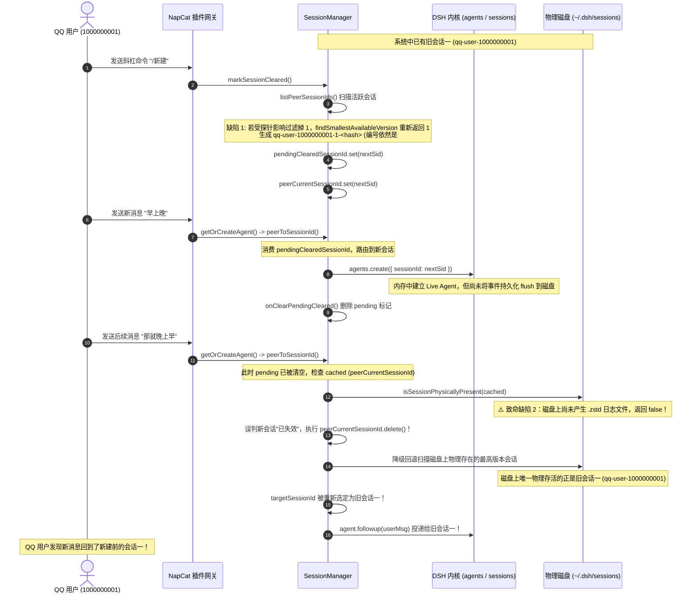

# 根因分析：QQ 发送 /新建 后重复生成会话一及消息回退旧会话缺陷

- **日期**：2026-10-22
- **责任模块**：`src/gateway/session.ts` 与 `src/gateway/session/`（寻址、编号推导与物理存在性检查）
- **关联提交**：`31af43a` (编号空缺填补与短哈希防撞)、`26d6876` (删除会话物理探针检测)
- **状态**：根因已彻底查明，提出修复方案，待用户确认

---

## 1. 结论摘要

用户的观察与判断完全准确，该问题确实是由最近的两次更新（`31af43a` 与 `26d6876`）相互交织引起的。

核心根因包括以下两点：
1. **新会话磁盘落盘延迟被误判为“物理不存在”，缓存被粗暴删除并回退旧会话**：  
   `26d6876` 引入了严苛的磁盘探针 `isSessionPhysicallyPresent`。但 DSH 刚创建的新会话在内存处于活动状态、尚未将 turn 事件 flush 到磁盘时，磁盘上根本没有 `session.v4.jsonl.zstd`。  
   当 NapCat 收到后续消息时，`peerToSessionId` 检查 `this.isSessionPhysicallyPresent(cached)` 判定为 `false`，不仅**直接把新会话缓存删除**，还在降级全量扫描中**重新选中了磁盘上唯一物理存在的旧会话一**，导致消息被送回新建前的旧会话；
2. **First Missing Positive（空缺填补）扫描受磁盘探针过滤影响，误判会话一空缺**：  
   在 `/新建` 扫描 `activeSessionIds = this.listPeerSessionIds(peer)` 时，因为旧会话或内存会话在探针中未被完全命中，导致 `activeVersions` 为空或缺失 `1`，`findSmallestAvailableVersion` 算出的版本号依然是 `1`。配合短哈希防撞生成了 `qq-user-xxxx-1-<hash>`，其标题依然格式化为 `#1`，导致界面上出现两个“会话一”。

---

## 2. 详细执行时序与缺陷链路复现



---

## 3. 代码具体位置与根因剖析

### 3.1 致命回退点：`peerToSessionId` 对缓存会话的激进失效判定
- **代码位置**：[`src/gateway/session.ts`](file:///f:/Project/dsh-napcat-bridge/src/gateway/session.ts#L310-L316)
```typescript
    const cached = this.peerCurrentSessionId.get(peer);
    if (cached) {
      if (!this.isSessionArchived(cached) && this.isSessionPhysicallyPresent(cached)) {
        return cached;
      }
      this.peerCurrentSessionId.delete(peer);
    }
```
- **问题分析**：
  `cached` 本是刚刚由当前进程创建并绑定的活动会话。但由于 DSH 会话写入磁盘具有异步性，刚创建或正在对话的会话在内存中正常存活，磁盘上却尚未生成日志文件。  
  `isSessionPhysicallyPresent(cached)` 返回 `false`，导致代码把正在使用的当前会话直接从内存删除，并降级触发后方的磁盘重新寻址，将路由强行拽回了磁盘上有旧日志的“新建前的那个会话一”。

### 3.2 空缺推导漏洞：`markSessionCleared` 的版本推导未将当前会话版本保底计入
- **代码位置**：[`src/gateway/session.ts`](file:///f:/Project/dsh-napcat-bridge/src/gateway/session.ts#L450-L466)
```typescript
    // 1. 扫描当前 peer 的未归档活跃会话
    const activeSessionIds = this.listPeerSessionIds(peer);
    let maxKnownRound = 0;
    const activeVersions: number[] = [];
    for (const sid of activeSessionIds) { ... }

    let round = maxKnownRound;
    const nextVersion = findSmallestAvailableVersion(activeVersions);
```
- **问题分析**：
  `activeVersions` 完全依赖 `listPeerSessionIds` 的探测结果。只要在某种时序或缓存状态下 `listPeerSessionIds` 未把当前会话计入，`activeVersions` 就会缺失当前会话的版本号（例如 `1`），导致 `findSmallestAvailableVersion` 依然返回 `1`。  
  按设计，用户在会话一敲 `/新建`，无论历史会话集合如何，**新会话的编号绝不能等于当前正在被清理的会话编号**，必须至少排在当前版本之后或明确跳过当前版本。

### 3.3 探针语义重合缺陷：`isSessionPhysicallyPresent` 混淆了“未落盘的内存活动会话”与“已在磁盘被物理删除的死会话”
- **代码位置**：[`src/gateway/session/persistence.ts`](file:///f:/Project/dsh-napcat-bridge/src/gateway/session/persistence.ts#L55-L118)
- **问题分析**：
  在 `26d6876` 中，为了防止桌面端删除会话后因为内存缓存句柄而无法重建，探针移除了内存状态。但未考虑：**当前进程主动持有并处于生命周期中的 `activeHandles` 或 `ctx.agents` 且未被归档时，属于合法的新建中会话**，不能仅因磁盘尚未产生持久化日志就断定其“物理已死亡”。

---

## 4. 建议修复方案

为彻底根治此问题，建议采取以下三项协同防护：

1. **会话缓存保护与内存存活互锁**：
   在 `peerToSessionId` 校验 `cached` 时，若 `this.activeHandles.has(cached)` 或 `ctx.agents.get(cached)` 正在内存中存活，且未被归档，视为合法存活会话，严禁粗暴将其从 `peerCurrentSessionId` 中剔除；
2. **`/新建` 编号推导绝对前进保证**：
   在 `markSessionCleared` 推导 `nextVersion` 时，将当前被清理会话的版本号 `currentVersion` 强制纳入已占用版本集合（`activeVersions.push(currentVersion)`），确保新建会话的版本号必然严格大于或不等于当前会话编号；
3. **探针区分“新建待写状态”与“已被外部删除状态”**：
   对于刚通过 `agents.create` 新建、尚未完成首次落盘的会话，在 `activeHandles` 内部打上创建中保护标记，直至其首次落盘或确认销毁。

---

## 5. 修复落地与验证记录

### 5.1 实施要点
1. **`src/gateway/session.ts`**：
   - 引入 `isSessionActiveOrPresent(sessionId)`，在 `peerToSessionId`、`listPeerSessionIds` 中统合物理存在与活动句柄保护，未落盘的合法新会话不再被粗暴剔除缓存；
   - `markSessionCleared` 保底将当前会话版本纳入占用集合，且当 `round === currentRound && nextVersion === currentVersion` 时强制自增跳过当前编号，杜绝原地重复编号。
2. **`src/gateway/session/agent-runner.ts`**：
   - `dispatchWakeup` 中会话重名修复：直接使用 `agent.session?.id` 替代重入查询 `peerToSessionId`，杜绝改名覆盖漏洞；
   - 引入 `persistedSessions` 状态追踪与 `isSessionZombie`，精准区分外部删除僵尸句柄与新建待落盘句柄。

### 5.2 契约测试与构建结果
- 先行契约测试：`tests/contract/session-new-command-persistence.test.ts` (3/3 通过)
- 回归契约测试：全量 6 组会话相关测试用例（36/36 项断言全部通过）
- `pnpm typecheck`：通过（零错误）
- `pnpm build`：成功构建，`dist/gateway/session.js` 与 `dist/gateway/session/agent-runner.js` 包含最新修复代码。

