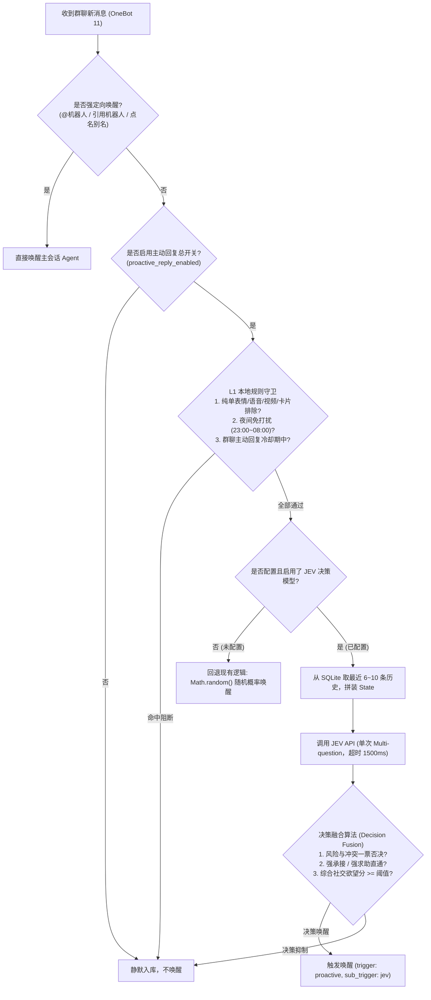

# 需求文档：JEV 决策模型前置群聊感知与主动唤醒机制

> **项目**: dsh-napcat-bridge  
> **文档版本**: v0.1（草稿，待审阅批注）  
> **日期**: 2026-10-22  
> **状态**: 需求构思收敛，待开工前实测与题目仿真验证  
> **前置要求**: 本需求开工前必须先完成第 3 节「开工前实测与模型能力查明」，未完成真实 API 仿真验证前不得进入业务代码编写  

---

## 0. 背景与目标

当前 `dsh-napcat-bridge` 插件的主动回复机制包含「随机概率唤醒」与「潜水超时冒泡」。其中，群聊普通消息的主动介入主要依赖基于伪随机数的概率唤醒（`Math.random() < probability`）。

### 0.1 当前痛点
1. **盲唤醒与社交尴尬（低情商插话）**：
   - 纯概率摇号不理解对话语境。当群友在讨论个人私事、两两对线吐槽或在发连环表情梗时，机器人一旦摇号命中就会强行介入，造成“人工智障”式的打扰；
2. **重型大模型前置代价高昂**：
   - 若将群聊每条入站消息都交给 DeepSeek / GPT 等全量生成式 LLM 进行前置判定，不仅 Token 成本剧增，而且 1~3 秒以上的思考与首字延迟在快节奏的 QQ 群聊中完全无法跟上对话流；
3. **隐式延续消息漏接**：
   - 群友在接机器人的上一句话时，往往不会长按消息去点击“引用”或手动 `@`。现有逻辑将其归为普通消息，导致对话链条频繁断裂。

### 0.2 本方案目标
引入 **TypeSafe JEV 决策模型（System 1 架构）** 作为群聊的前置直觉感知层：
- **语义级直觉判定**：单次推理并发评估多个社交维度，替代粗暴的随机摇号；
- **配置高度复用**：深度复用插件现有的 `persona`（人格设定）与 `behavior`（行为约束准则），用户无需额外配置冗长的判定提示词；
- **极低开销与延迟**：利用 JEV 不生成长文本、仅输入计费、单次调用 70ms~300ms 的特性，以最小成本实现高质量的群聊情商感知。

---

## 1. 术语与系统边界

| 术语 / 模块 | 含义与定位 | 本需求边界 |
|---|---|---|
| **JEV 模型** | TypeSafe AI 提出的 System 1 结构化决策模型（如 `typesafe/jev-1.13` / `jev-1.14`） | ✅ 作为可选的前置判别 API 接入 |
| **Noul 原语** | JEV 的布尔是非判断题型，直接输出 `0.0 ~ 1.0` 的校准概率 | ✅ 用于判定隐式承接、求助需要、行为风险等 |
| **Score 原语** | JEV 的有序评分题型，按离散等级阶梯输出加权分值 | ✅ 用于评估人设共鸣度、话题兴趣度 |
| **Choice 原语** | JEV 的离散多选分类题型，输出选项分类与置信度 | ✅ 用于识别社交场景动态（对线、私聊、开放讨论、复读） |
| **L1 规则守卫** | 本地代码实现的免打扰、冷却期、表情与卡片快速过滤 | ✅ 保持 0 成本前置，过滤后再请求 JEV |
| **L2 JEV 决策** | 请求 JEV API 执行多维语义感知与决策融合 | ✅ 本需求核心 |
| **全量 Agent 运行** | DSH 主会话启动 DeepSeek / 主大模型执行工具与文本生成 | ❌ 本需求不篡改 Agent 内部生成逻辑，仅控制唤醒门控 |

---

## 2. 核心架构：两级漏斗与社交感知网

整个前置感知体系采用 **“L1 规则守卫（零成本本地剪枝）+ L2 JEV 决策（高情商语义感知）”** 的两级漏斗架构：



### 2.1 零成本 L1 剪枝策略
高活跃群聊可能达到几十条/分钟的消息速率。为了避免无意义的 API 调用：
- 冷却期（刚主动回复完的 N 分钟内）直接在本地拦截，不调 JEV；
- 纯单个表情包、戳一戳、语音、视频、转发卡片等直接在本地排除；
- 夜间免打扰时段直接在本地拦截。

---

## 3. 开工前实测与模型能力查明（必做，阻塞开发）

> ⚠️ **红线原则**：在编写具体业务代码之前，必须先通过单独的脚手架脚本对 JEV 真实 API 进行能力查明与仿真验证，实测验证其对中文语境、多题组合、校准概率的表现。

### 3.1 实测验证清单

- [ ] **T1 · 中文理解与上下文承载边界**
  - **测试方式**：构造一段包含中文网络缩写、俚语（如“nb”、“打工人”、“绝了”、“求助大佬”）的群聊上下文，作为 `state` 传给 JEV；
  - **验收指标**：确认 JEV 是否能准确理解中文口语、表情文字化占位符（如 `[表情包:猫咪]`）；
- [ ] **T2 · 单次多题（Multi-Question）返回一致性与延迟基准**
  - **测试方式**：单次 Payload 挂载 5 道题（包含 3 个 `noul`、1 个 `score`、1 个 `choice`），连续测试 20 次；
  - **验收指标**：记录 API 首包平均耗时与 P99 耗时（目标 `< 350ms`）；验证 5 道题是否在同一次响应完整返回且类型与 Schema 完全对齐；
- [ ] **T3 · 隐式承接（Continuation）识别灵敏度**
  - **测试方式**：
    - Case A: 群友不点引用，紧跟机器人上一句发言追问（“真的假的，那老版本会崩吗？”）；
    - Case B: 群友发起完全无关的新话题（“今天中午吃肯德基吗？”）；
  - **验收指标**：Case A 的 `continuation` 得分需显著高于 Case B（Case A > 0.8，Case B < 0.2）；
- [ ] **T4 · 争吵与双人私聊（Conflict / Private Banter）避让灵敏度**
  - **测试方式**：模拟两名群友互相攻击或密集互动对线；
  - **验收指标**：`social_dynamic` 应准确归类为 `conflict` 或 `private_banter`，触发一票否决；
- [ ] **T5 · Persona & Behavior 注入后的立场对齐度**
  - **测试方式**：
    - Persona 设置为“硬核运维架构师”时，测试其对“K8s 故障” vs “美妆口红”的共鸣分差；
    - Behavior 设置为“绝对禁止参与任何政治或宗教讨论”时，输入边缘违禁话题，测试 `behavior_risk` 的概率变化。

---

## 4. 详细技术方案设计

### 4.1 State 上下文结构构建
复用 SQLite 历史消息与插件现有设置，无需新增 Prompt 输入框。

```markdown
# Role & Behavioral Guidelines
- Assistant Nickname: {bot_nickname}
- Aliases: {aliases}
- Persona:
{config.persona}
- Behavioral Constraints:
{config.behavior}

# Recent Group Chat Context (Chronological Order, Up to 8 messages)
[14:02:10] User1001(张三): 我们的 Redis 内存突然飙高到 95% 了，有人遇到过吗？
[14:02:25] [Assistant]: 可以先用 bigkeys 命令查一下是否有未设过期时间的大 Hash 键。
[14:02:40] User1002(李四): 查到了，好像是一个临时同步任务写入的 cache:* 键。
<<< LATEST INCOMING MESSAGE TO EVALUATE >>>
```

### 4.2 JEV 多维题目 Schema 定义

在单次请求中派发以下 5 个维度的题组：

```json
{
  "model": "{config.jev_model || 'typesafe/jev-1.14'}",
  "state": "{assembled_state}",
  "questions": {
    "continuation": {
      "type": "noul",
      "instructions": "Is the latest incoming message directly addressing, answering, mocking, or extending the topic/advice previously stated by the Assistant in the chat history, even without an explicit @ or quote?"
    },
    "persona_resonance": {
      "type": "score",
      "instructions": "Based on the Assistant's Persona and background in the state, how relevant, appealing, or expertise-aligned is the current discussion topic to the Assistant?",
      "criteria": ["completely_irrelevant", "weakly_related", "moderately_relevant", "strongly_resonant"]
    },
    "social_dynamic": {
      "type": "choice",
      "instructions": "What is the social dynamic of this conversation?",
      "criteria": {
        "open_discussion": "Open public discussion, technical inquiry, group-wide debate, or casual chatting suitable for the group",
        "private_banter": "Exclusive, intimate 1-on-1 dialogue, private routine sharing, or personal inside jokes between specific members",
        "conflict": "Heated arguments, quarreling, hostile roasting, venting anger, or interpersonal friction",
        "meme_echo": "Repetitive slogan spamming, continuous identical phrase echoing, or meaningless emotional noise"
      }
    },
    "unresolved_help": {
      "type": "noul",
      "instructions": "Does the chat indicate an unanswered question, confusion, trouble, or request for advice/information that has not yet been resolved by other group members?"
    },
    "behavior_risk": {
      "type": "noul",
      "instructions": "Does participating in this conversation risk violating any of the Assistant's negative constraints, safety rules, or behavioral restrictions specified in the state?"
    }
  }
}
```

### 4.3 决策融合算法（Decision Fusion）

当 JEV 返回各维度的判定结果后，代码层按照以下步骤执行社交仲裁：

1. **第一阶段：一票否决门禁（Veto Gate）**
   - 若 `behavior_risk.noul >= 0.6`：**立即抑制（不唤醒）**，安全第一；
   - 若 `social_dynamic.choice` 为 `"conflict"`（争端）或 `"private_banter"`（排他私聊）：**立即抑制（不唤醒）**，不当局外破坏者或当火上浇油的炮灰；
   - 若 `social_dynamic.choice` 为 `"meme_echo"`（纯复读刷屏）且当前 Persona 非搞笑/吐槽役：**立即抑制（不唤醒）**，保持静默围观。

2. **第二阶段：顺畅承接直通车（Continuation Fast-Path）**
   - 若 `continuation.noul >= 0.75`：**判定唤醒**。
   - *逻辑*：群友正在接机器人的话，此时回复的优先级最高，即使话题本身不是核心专长，也必须保持对话的自然连贯。

3. **第三阶段：价值贡献直通车（Help Needed Fast-Path）**
   - 若 `unresolved_help.noul >= 0.8` 且 `social_dynamic.choice === "open_discussion"`：**判定唤醒**。
   - *逻辑*：群内有明确疑问且未被其他人解决，助手出场具有极高的实际功能价值。

4. **第四阶段：社交欲望加权评分（Social Desire Index）**
   - 对常规开放式闲聊，计算机器人的“发言欲望值”：
     $$\text{Desire} = 0.65 \times \text{persona\_resonance.score} + 0.35 \times \text{unresolved\_help.noul}$$
   - 若 $\text{Desire} \ge \text{config.jev\_threshold}$（默认 `0.70`）：**判定唤醒**；否则**静默**。

---

## 5. 边缘场景与情商表现对照表

| 场景序号 | 群聊典型语境输入 | JEV 核心判断维度 | 最终决策行为 | 设计理由与情商考量 |
|:---:|---|---|:---:|---|
| **E1** | 群友没 @ 也没引用，但在回复机器人的上句话：“真的假的，我怎么没感觉” | `continuation > 0.8` | **唤醒** | 承接上下文，避免机械的“不 @ 就不理” |
| **E2** | 两个群友因为游戏输了正在激烈对线互喷脏话 | `social_dynamic: "conflict"` | **抑制** | 一票否决。严禁介入人类纷争，不激化矛盾 |
| **E3** | 两个群友在聊“今晚去哪吃饭、几点下班接你”等私人事务 | `social_dynamic: "private_banter"` | **抑制** | 避免成为不识趣的“电灯泡” |
| **E4** | 全群正在排队复读“+1”、“好耶”刷屏 10 条以上 | `social_dynamic: "meme_echo"` | **抑制** | 避免破坏队形，避免严肃科普煞风景 |
| **E5** | 群友讨论涉及违禁或行为规范中明令禁止的争议议题 | `behavior_risk > 0.6` | **抑制** | 负向约束一票否决，遵守 Behavior 安全边界 |
| **E6** | 群友询问专业技术问题，无人回答，且切中 Persona 专长 | `unresolved_help > 0.8` 且 `persona_resonance > 0.7` | **唤醒** | 展现专业能力与助手机能，高价值介入 |
| **E7** | 群友讨论纯与机器人设定完全无关的领域（如二次元猫娘面对水泥浇筑工艺） | `persona_resonance < 0.2` 且 `unresolved_help < 0.3` | **抑制** | 不懂装懂或乱插话会破坏角色真实感 |

---

## 6. 配置项规划与 Web UI 呈现

在现有设置卡片的「主动回复（proactive）」Tab 中扩展以下配置，完全向后兼容：

```ts
export const BridgeConfigSchema = z.object({
  // ... 既有配置保持不变 ...

  // 1. JEV 决策决策唤醒总开关
  jev_enabled: z.boolean().default(false).volatile()
    .description('启用 JEV 语义决策唤醒：替代群聊普通消息的随机概率盲唤醒，通过 JEV 模型智能感知语境、话题相关度与群聊氛围'),

  // 2. JEV 接口端点
  jev_api_url: z.string().default('https://api.typesafe.ai/v1/systemone').volatile()
    .description('JEV API 端点地址 (支持 TypeSafe 官方或 OpenRouter 等代理地址)'),

  // 3. JEV 鉴权密钥 (脱敏)
  jev_api_key: z.string().default('').role('secret').volatile()
    .description('JEV API 鉴权密钥 (Bearer Token)'),

  // 4. JEV 模型名称
  jev_model: z.string().default('typesafe/jev-1.14').volatile()
    .description('使用的 JEV 决策模型名称 (默认 typesafe/jev-1.14)'),

  // 5. 综合发言欲望门槛
  jev_threshold: z.number().default(0.70).volatile()
    .description('主动插话欲望门槛 (0.0~1.0 之间的小数，默认 0.70。数值越低越热情活跃，数值越高越严谨克制)'),

  // 6. 前置历史消息回溯深度
  jev_context_size: z.number().default(8).volatile()
    .description('提供给 JEV 决策参考的前置群聊上下文条数 (默认 8 条，范围 3~15)'),
});
```

### 6.1 优雅降级与网络容错机制
- **超时控制**：网络调用 JEV 必须设置严格的超时中断（`AbortController`，建议 `1500ms`）；
- **故障静默（Fail-Safe）**：当网络抖动、超时、欠费或 API 抛错时，**默认静默不唤醒**，记录 debug 日志，绝不阻断正常消息入库与后续流转；
- **回退兼容**：若 `jev_enabled` 开启但未填写 `jev_api_key`，或 `jev_enabled` 为 false，系统自动无缝回退到原有的 `proactive_random_enabled` 随机概率判定。

---

## 7. 后续推进路线

1. **第一阶段（开工前实测）**：
   - 编写 `devlog/scratch/test_jev_capabilities.ts` 临时测试脚本；
   - 注入多组典型中文群聊语料，实测 JEV API 的时延、中文理解准确度及多题输出格式，查明能力边界并回填第 3 节；
2. **第二阶段（契约测试先行 TDD）**：
   - 编写针对 JEV 请求组装器、State 构建器、融合决策算法的单元测试与 Mock 契约测试；
3. **第三阶段（模块实现与装配）**：
   - 实现 JEV 客户端封装；
   - 将 JEV 决策挂入 `shouldWakeup()` 流程；
   - 更新 Schema、Web UI 表单组件与配置持久化；
4. **第四阶段（真机闭环与交付）**：
   - 运行全量测试用例并执行 `pnpm build`；
   - 进行真实群聊联调与验收报告交付。
