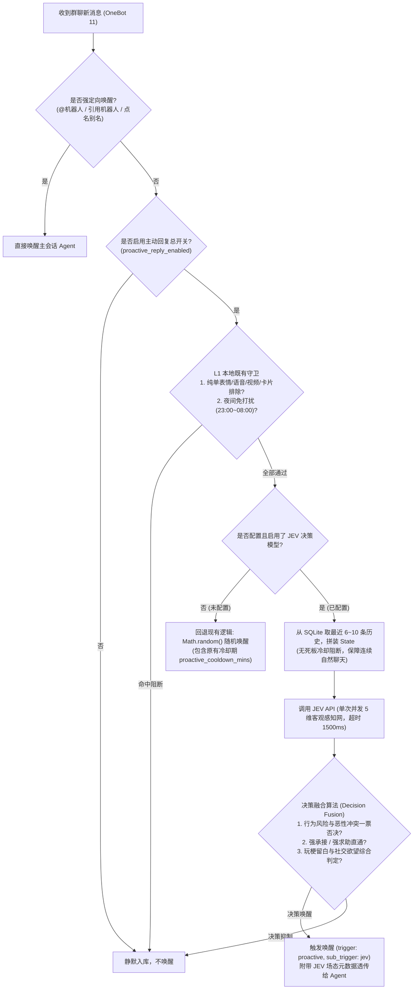
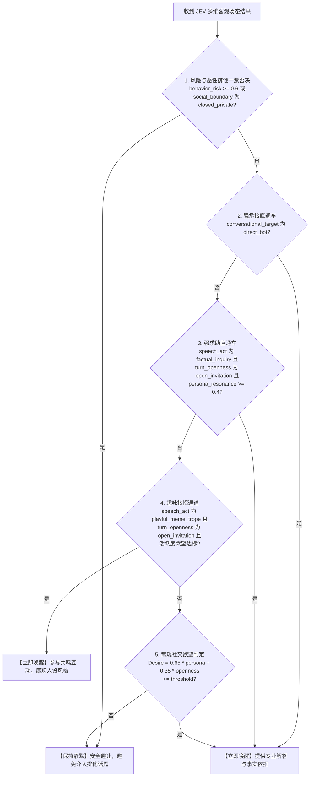

# 需求文档：JEV 决策模型前置群聊感知与主动唤醒机制

> **项目**: dsh-napcat-bridge  
> **文档版本**: v0.3（逻辑精修版，修正连续对话冷却偏差）  
> **日期**: 2026-10-22  
> **状态**: 方案定稿，开工前沙盒实测验证通过，待进入契约测试与实现阶段  
> **实测验证参考**: [JEV模型本地实测与题目有效性探查.md](./archive/JEV模型探查与实测_261022/JEV模型本地实测与题目有效性探查.md)  

---

## 变更记录 (Changelog)

| 版本 | 日期 | 变更内容提要 |
|:---:|:---:|---|
| **v0.3** | 2026-10-22 | 1. **修正连续对话冷却偏差**：移除 JEV 决策模式下的回复冷却限制。连续多轮交流属于正常群聊生态，JEV 通过语义场态具备动态调控能力，叠加固定冷却会导致连续追问时漏回；原 `proactive_cooldown_mins` 仅在回退至传统随机概率唤醒时生效；<br>2. 规范文档陈述口径，采用客观中立的技术规格叙述风格；<br>3. 关联引用本地沙盒实测日志 [JEV模型本地实测与题目有效性探查.md](./archive/JEV模型探查与实测_261022/JEV模型本地实测与题目有效性探查.md)；<br>4. 统一流程图、Schema 定义、决策融合伪代码与情商矩阵之间的字段命名。 |
| **v0.2** | 2026-10-22 | 1. 回填第 3 节本地沙盒全量实测结论（T1~T6 全部验证通过）；<br>2. 确立**“为 Agent 赋能而不是替 Agent 做决定”**的设计准则，定位 JEV 为客观社交场态感知器官（Sensory Organ），打通感知元数据向后续 Agent 透传通道；<br>3. 厘清**“语义理解能力 vs 全知世界知识”**边界，确立中立客观、触及语用学本质的选项设计原则；<br>4. 破除“复读即机械重复相同字符串”狭隘认知，升维为“信息增量 vs 纯情绪共鸣与社交附和”；<br>5. 引入发癫文学荒谬夸张、熟人打闹互损 vs 真实冲突、反讽阴阳怪气等抽象网络亚文化的客观感知网；<br>6. 升级决策融合仲裁架构，新增接梗调侃通道，解决机器人在群聊玩梗氛围下一味沉默的痛点。 |
| **v0.1** | 2026-10-22 | 初始草案：梳理 JEV 决策模型特性、两级漏斗架构、初步 5 维题目设计与配置规划。 |

---

## 0. 背景与核心设计哲学

当前 `dsh-napcat-bridge` 插件的主动回复机制包含「随机概率唤醒」与「潜水超时冒泡」。其中，群聊普通消息的主动介入主要依赖基于伪随机数的概率唤醒（`Math.random() < probability`）。

### 0.1 当前痛点
1. **盲目唤醒造成非预期打扰**：
   - 纯概率摇号无法理解对话语境。当群友讨论个人私事、排他性争吵或发送连续表情时，无差别的概率命中容易造成生硬打扰；
2. **保守静默策略导致错失互动契机**：
   - 群聊交流常包含调侃、反讽、网络迷因与自嘲修辞。若系统仅响应显式提问或机械匹配，面对非严肃语境一律保持沉默，易导致交互体验单调断联；
3. **固定冷却机制割裂连续多轮对话**：
   - 原有随机概率机制为平抑频繁插话波动设置了固定冷却期（默认 10 分钟）。但在正常群聊中，群友顺着机器人前述回复进行连续追问属于高频场景，固定冷却会导致机器人强制闭嘴，引发消息漏回；
4. **全量生成式大模型前置判定代价过高**：
   - 若将入站消息逐条输入 DeepSeek / GPT 等全量 LLM 进行前置过滤，不仅 Token 成本显著增加，1~3 秒以上的思考与首字延迟在群聊即时流中也难以保证时效；
5. **隐式承接消息存在漏接**：
   - 用户在回应机器人上一条发言时，往往省略显式 `@` 或引用操作。现有逻辑将其视为普通消息，导致上下文链条中断。

### 0.2 核心哲学：为 Agent 赋能，而不是替 Agent 做决定
- **JEV 定位为高保真社交场态感知器官（Sensory Organ），而非硬编码决策拦截器**：
  - 避免要求 JEV 在单道题目中直接判定“是否应该回复”，以防止复合推理过载和规则僵化；
  - 将 JEV 定位为前置直觉感知层，在低延迟（70~300ms）下客观测量会话的场态属性：**信息增量、社交距离、交流目标、修辞张力、攻守姿态与留白空间**；
  - 测得的客观场态数据，既用于前置做出稳健的唤醒仲裁，**也作为上下文元数据（Context Metadata）透传给被唤醒的 Agent**，协助主模型在生成回复时准确识别当前语境是严肃技术求助还是调侃自嘲，从而组织恰当的回复策略。

### 0.3 关键边界认知：语义理解能力 vs 全知世界知识
- **JEV 的能力核心在于深层语义结构与语用学辨析，不具备实时全网流行梗百科知识**；
- 题目设计需遵循**中立、客观与语用学通用属性**：选项描述不依赖特定小众亚文化背景，而是从通用的语言学特征（如言意一致性、荒谬修辞、假装互损、单向自语等）出发，使 JEV 专注发挥其语义分类专长。

---

## 1. 术语与系统边界

| 术语 / 模块 | 含义与定位 | 本需求边界 |
|---|---|---|
| **JEV 模型** | TypeSafe AI 提出的 System 1 结构化决策模型（支持本地 OpenJEV 与云端 API） | ✅ 作为可选的前置判别端点接入 |
| **客观场态感知网** | 基于 Choice、Score、Binary 原语构建的正交语用感知题组 | ✅ 本需求核心技术资产 |
| **L1 既有规则守卫** | 项目既有的消息形态排除（纯表情/音视频/卡片）、夜间免打扰（DND）、自身消息过滤 | ✅ 保持 0 成本本地硬过滤，过滤后再请求 JEV；**注：JEV 模式不设固定冷却** |
| **L2 JEV 决策** | 请求 JEV API 执行多维语义感知、决策融合与元数据提取 | ✅ 本需求核心 |
| **全量 Agent 运行** | DSH 主会话启动 DeepSeek / 主大模型执行工具与文本生成 | 🔄 接受 JEV 场态元数据透传，丰富回复语境 |

---

## 2. 核心架构：两级漏斗与场态感知网

前置感知体系采用 **“L1 既有规则守卫（零成本本地剪枝）+ L2 JEV 决策（语义场态感知）”** 的两级漏斗架构：



### 2.1 零成本 L1 剪枝策略（复用项目已有能力）
为避免高频群聊产生无意义的 API 调用，复用项目现有的底层门禁逻辑：
- 纯单个表情包、戳一戳、语音、视频、转发卡片等通过 `isExcludedFromProactive()` 直接在本地排除；
- 夜间免打扰时段（23:00~08:00）通过 `isNightDnd()` 本地拦截；
- 开启 `proactive_only_text` 纯文本模式时，非纯文本消息在本地拦截。

> 💡 **设计说明：关于 JEV 模式下不设固定冷却期的考量**  
> 原有的 `proactive_cooldown_mins`（默认 10 分钟）主要用于限制随机概率采样带来的无规律打扰。  
> 在 JEV 语义感知链路中，是否触发回复由交流目标归属、求助状态及互动开放度实时评估。多轮连续追问属于正常交流形态，若叠加固定冷却限制，会导致后续追问被机制拦截而漏回。  
> 因此，**JEV 模式下不应用固定冷却限制，每轮消息均动态评估**；原冷却期仅在回退至传统随机概率机制时生效。

---

## 3. 开工前实测与模型能力查明

已在本地沙盒环境（**RTX 2060 SUPER + Qwen3-4B-Instruct 8-bit 量化**）完成两轮测试验证，具体用例与测试数据详见 [devlog/archive/JEV模型探查与实测_261022/JEV模型本地实测与题目有效性探查.md](./archive/JEV模型探查与实测_261022/JEV模型本地实测与题目有效性探查.md)。

### 3.1 实测验证清单与结论

- [x] **T1 · 中文理解与上下文承载边界**
  - **实测结论**：模型对中文口语表述与长时序上下文具备确定的解析能力，可从消息流中准确识别目标归属。
- [x] **T2 · 单次多题（Multi-Question）返回一致性与延迟基准**
  - **实测结论**：单题前向约 260~330ms，本地串行 4~5 题总耗时 900~1400ms；云端并行 API 预期在 100~300ms 之间。全部题目在单次请求中稳定对齐 Schema 输出。
- [x] **T3 · 隐式承接（Continuation）识别灵敏度**
  - **实测结论**：用户顺着机器人发言追问或反驳时，判定为针对机器人的概率达到 **`1.0000`**；无关话题概率为 **`0.0000`**，具备明确的分离度。
- [x] **T4 · 恶性争吵 vs 熟人打闹互损的边界辨识**
  - **实测结论**：面对带有表面贬损词汇的熟人戏谑，模型能以 100% 概率识别为熟人打闹（`playful_banter`），恶意冲突概率为 0.0；面对真实攻击言论时准确输出 `hostile_conflict`，避免了基于敏感词匹配的机械误判。
- [x] **T5 · 抽象发癫文学与反讽修辞识别**
  - **实测结论**：自嘲发癫语料被准确识别为“荒谬夸张修辞（`hyperbolic_absurdity`）+ 存在互动留白（`turn_openness: 1.0`）”；删库反讽语料能以 100% 置信度锁定为反讽戏谑（`irony`），有效穿透非字面含义。
- [x] **T6 · 复读与跟风本质探明**
  - **实测结论**：无论是重复相同字符还是变体情绪附和（如连续发送“芜湖起飞/狂喜”），模型均能统一识别为“无信息增量的情绪共鸣与社交附和”。

---

## 4. 详细技术方案设计

### 4.1 State 上下文结构构建
复用插件现有的 `persona` 与 `behavior`，无需增加用户额外的 Prompt 配置负担。

```markdown
# Role & Behavioral Guidelines
- Assistant Nickname: {bot_nickname}
- Aliases: {aliases}
- Persona:
{config.persona}
- Behavioral Constraints:
{config.behavior}

# Recent Group Chat Context (Chronological Order, Up to 8 messages)
[14:02:10] User1001(张三): 我们的 Redis 内存突然飙高到 95% 了，有人遇到过吗？
[14:02:25] [Assistant]: 可以先用 bigkeys 命令查一下是否有未设过期时间的大 Hash 键。
[14:02:40] User1002(李四): 查到了，好像是一个临时同步任务写入的 cache:* 键。
<<< LATEST INCOMING MESSAGE TO EVALUATE >>>
```

### 4.2 全景社交场态感知原语网定义

单次请求中并发派发以下 5 组正交、中立客观的语用分析题目：

```json
{
  "model": "{config.jev_model || 'typesafe/jev-1.14'}",
  "state": "{assembled_state}",
  "questions": {
    "conversational_target": {
      "type": "choice",
      "instructions": "According to the context, what is the direct target of this latest incoming message?",
      "criteria": {
        "direct_bot": "Directly addressing, questioning, challenging, joking with, or continuing the topic from the Assistant",
        "specific_human": "Specifically interacting with, replying to, or bantering with another human user",
        "public_broadcast": "Public broadcast to the whole group, general monologue, or open topic without a specific target"
      }
    },
    "social_boundary": {
      "type": "choice",
      "instructions": "What is the social boundary and privacy level of the current interaction?",
      "criteria": {
        "closed_private": "Highly exclusive 1-on-1 private talk, intimate affairs, or personal hostile conflict",
        "open_public": "Open public space interaction welcoming group-wide participation or shared discussion"
      }
    },
    "speech_act_mode": {
      "type": "choice",
      "instructions": "What is the pragmatic speech act mode of this latest message?",
      "criteria": {
        "factual_inquiry": "Factual inquiry, technical reasoning, explicit help-seeking, or knowledge sharing",
        "playful_meme_trope": "Internet memes, playful bantering, hyperbolic self-deprecation, or humorous jokes",
        "emotional_resonance": "Pure emotional venting, echoing others' mood, slogan repeating, or celebration noises",
        "phatic_checkin": "Phatic greeting, presence testing, or casual presence confirmation"
      }
    },
    "turn_openness": {
      "type": "choice",
      "instructions": "Does the message leave an open invitation or conversational punchline for others to chime in?",
      "criteria": {
        "open_invitation": "Leaves a great conversational opening, humorous bait, punchline, or unanswered question",
        "conversational_closure": "Topic is self-contained, settled, question resolved, or naturally concluded"
      }
    },
    "persona_resonance": {
      "type": "score",
      "instructions": "How relevant and appealing is this topic to the Assistant's declared persona and expertise?",
      "criteria": ["irrelevant", "general_knowledge", "core_expert"]
    },
    "behavior_risk": {
      "type": "noul",
      "instructions": "Does participating in this conversation risk violating the Assistant's negative behavioral constraints?"
    }
  }
}
```

### 4.3 升级版决策融合算法（Decision Fusion）



1. **第一阶段：一票否决门禁（Veto Gate）**
   - 若 `behavior_risk >= 0.6`：**立即抑制**；
   - 若 `social_boundary === "closed_private"`（个人业务对账、情侣私聊、人际攻击争端）：**立即抑制**；
2. **第二阶段：顺畅承接直通车（Continuation Fast-Path）**
   - 若 `conversational_target === "direct_bot"`（追问、反驳或回应机器人）：**判定唤醒**；连续对话正常流转，不设固定冷却限制；
3. **第三阶段：价值贡献直通车（Help Needed Fast-Path）**
   - 若 `speech_act_mode === "factual_inquiry"` 且 `turn_openness === "open_invitation"` 且人设契合度 `persona_resonance >= 0.4`：**判定唤醒**；
4. **第四阶段：趣味互动接招通道（Playful Banter Fast-Path）**
   - 若消息属于网络调侃、发癫自嘲（`playful_meme_trope`），且留有明确的接话空间（`open_invitation`），结合当前配置的“主动发言欲望”门限判定唤醒，使机器人适度融入轻松交流语境；
5. **第五阶段：元数据透传（Metadata Passing）**
   - 触发唤醒时，将 JEV 测得的 `{ speech_act, target, boundary, openness }` 封装进 `WakeupPayload.metadata`，透传给主 Agent，为主模型规划回复语调提供明确的上下文线索。

---

## 5. 真实复杂群聊语境表现矩阵

| 场景序号 | 典型群聊语料输入 | JEV 客观场态识别 | 最终决策行为 | 设计考量与预期表现 |
|:---:|---|---|:---:|---|
| **E1** | 群友未显式引用或 @，紧接追问：“真的假的，那线上跑 bigkeys 会不会阻塞主线程？” | `target: direct_bot`<br>`turn: open_invitation` | **唤醒 (承接通道)** | 顺畅承接上下文，保障未显式引用的连续追问正常响应 |
| **E2** | 两人争吵对线：“你这把打得像个废物，现实里也是个没人要的卢瑟吧？” | `social: closed_private`<br>`risk: 0.8` | **抑制 (一票否决)** | 识别为真实恶意冲突，执行一票否决，避免介入用户间的人身攻击 |
| **E3** | 好友互损打闹：“哈哈哈哈就你长嘴天天显摆，不会买把钱捐给希望工程，大冤种爬！” | `speech: playful_meme`<br>`social: open_public`<br>`target: specific_human` | **抑制/低频旁观** | 识别为非恶意打闹，若未指定 Bot 为交流目标则保持静默 |
| **E4** | 自嘲发癫文学：“今天又是给资本家当牛做马的一天，脑浆被榨干，我真的哭死。” | `speech: playful_meme`<br>`turn: open_invitation`<br>`social: open_public` | **可唤醒 (接梗通道)** | 识别为自嘲修辞且存在交互留白，可根据人设和欲望阈值参与共情互动 |
| **E5** | 反讽阴阳怪气：“哇你可真是绝世大天才，把生产用户表全删了，明天竞聘CTO吧？” | `rhetorical: irony`<br>`turn: open_invitation` | **抑制或精准吐槽** | 识别为反讽修辞，避免按字面赞同直接应答 |
| **E6** | 抛梗打破冷场：“今天不是周四吗，谁来V我50看看实力，怎么群里安静如鸡？” | `speech: playful_meme`<br>`turn: open_invitation` | **可唤醒 (破冰通道)** | 识别为活跃气氛的互动诱饵，Bot 可适度接话参与 |
| **E7** | 全群排队复读：“好耶！”、“好耶！”、“好耶！”连续刷屏 | `speech: emotional_resonance`<br>`turn: conversational_closure` | **抑制 (队形保护)** | 识别为无信息增量的情绪附和，保持静默以维护原有社群互动节奏 |

---

## 6. 配置项规划与 Web UI 呈现

在现有设置卡片的「主动回复（proactive）」Tab 中扩展以下配置，完全向后兼容：

```ts
export const BridgeConfigSchema = z.object({
  // ... 既有配置保持不变 ...

  // 1. JEV 语义决策唤醒总开关
  jev_enabled: z.boolean().default(false).volatile()
    .description('启用 JEV 语义决策唤醒：替代群聊普通消息的随机概率盲唤醒，通过 JEV 决策模型智能感知语境、话题相关度与群聊氛围（启用后普通消息不设固定冷却，保障连续交流流畅）'),

  // 2. JEV 接口端点
  jev_api_url: z.string().default('https://api.typesafe.ai/v1/systemone').volatile()
    .description('JEV API 端点地址 (支持 TypeSafe 官方或 OpenRouter 等代理地址，也可指向本地 OpenJEV)'),

  // 3. JEV 鉴权密钥 (脱敏)
  jev_api_key: z.string().default('').role('secret').volatile()
    .description('JEV API 鉴权密钥 (Bearer Token，本地部署可留空)'),

  // 4. JEV 模型名称
  jev_model: z.string().default('typesafe/jev-1.14').volatile()
    .description('使用的 JEV 决策模型名称 (默认 typesafe/jev-1.14)'),

  // 5. 综合发言欲望门槛
  jev_threshold: z.number().default(0.70).volatile()
    .description('主动插话欲望门槛 (0.0~1.0 之间的小数，默认 0.70。数值越低越倾向于开放互动，数值越高越保持严谨克制)'),

  // 6. 前置历史消息回溯深度
  jev_context_size: z.number().default(8).volatile()
    .description('提供给 JEV 决策参考的前置群聊上下文条数 (默认 8 条，范围 3~15)'),
});
```

### 6.1 优雅降级与网络容错机制
- **超时控制**：网络调用 JEV 设置严格的超时中断（`AbortController`，默认 `1500ms`）；
- **故障静默（Fail-Safe）**：当网络抖动、超时、欠费或 API 抛错时，**默认静默不唤醒**，记录 debug 日志，不阻断正常消息入库与后续流程；
- **回退兼容**：若 `jev_enabled` 开启但未填写 `jev_api_key`（且非本地地址），或 `jev_enabled` 为 false，系统自动无缝回退到原有的 `proactive_random_enabled` 随机概率判定（此时原有 `proactive_cooldown_mins` 冷却保护生效）。

---

## 7. 后续推进路线 (开工阶段)

1. **第一阶段（开工前实测）**：✅ 已完成！本地 OpenJEV 沙盒全部验证闭环（详见 [devlog/JEV模型本地实测与题目有效性探查.md](./JEV模型本地实测与题目有效性探查.md)）；
2. **第二阶段（契约测试先行 TDD）**：
   - 编写针对 JEV 请求 Payload 组装器、State 构建器、多维结果解码器与决策融合算法的单元契约测试；
3. **第三阶段（模块实现与装配）**：
   - 实现独立的 `src/gateway/jev.ts` 客户端模块；
   - 在 `shouldWakeup()` 中装配 JEV 门控链路；
   - 更新 Schema、Web UI 设置卡片与配置持久化；
4. **第四阶段（真机闭环与构建验收）**：
   - 执行 `pnpm test` 与 `pnpm build`，验证打包产物；
   - 进行端到端验证并交付。
